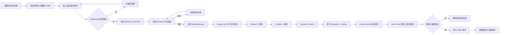
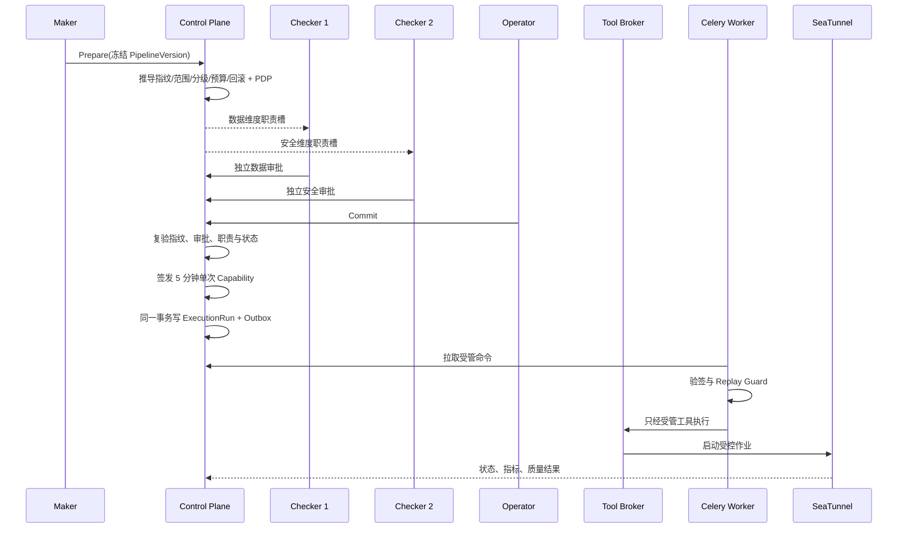
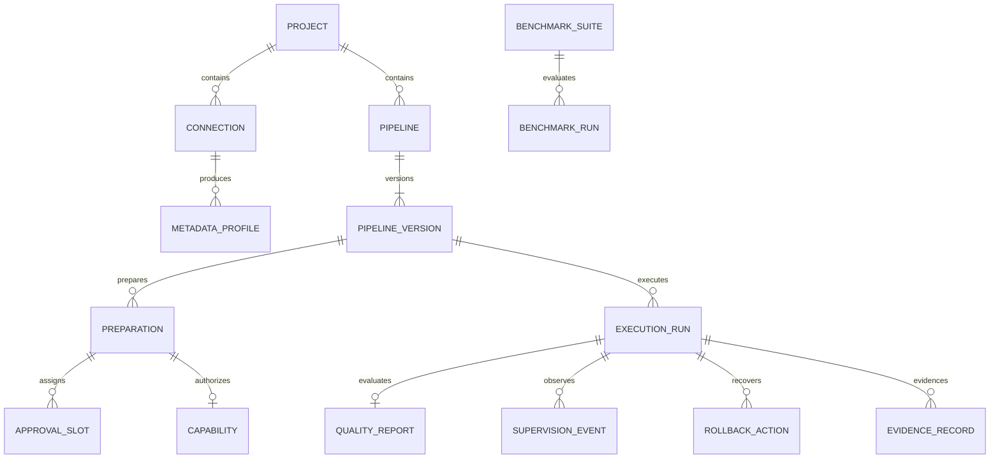

# 生产级 ETL-Agent 数据集成平台 PRD

| 项目 | 内容 |
| --- | --- |
| 文档版本 | v1.0 |
| 文档状态 | 需求基线草案 |
| 编制日期 | 2026-11-23 |
| 产品名称 | 生产级 ETL-Agent 数据集成平台 |
| 需求来源 | 《生产级 ETL-Agent 数据集成平台-项目要求》第 2.8 节 |
| 目标阶段 | 生产级交付 |
| 主要读者 | 产品、设计、前端、后端、数据平台、测试、安全、运维、审计 |

## 0. 文档定位与约束

### 0.1 文档定位

本文档把原始项目要求转化为可设计、可开发、可测试、可验收的产品需求基线，覆盖：

- 产品目标、用户角色、权限边界和端到端业务闭环。
- 页面信息架构、核心交互和状态变化。
- 功能需求、协议契约、领域对象、接口语义与非功能要求。
- 安全控制、验收标准、评测方案和交付清单。
- 原始要求与 PRD 条目、验收用例之间的可追溯关系。

### 0.2 需求约束

本 PRD 遵守以下强制约束：

1. **范围约束**：不删减原始文档规定的功能范围。本文新增内容仅用于明确交互、数据、接口和验收方式，不扩大业务目标。
2. **安全约束**：任何不经审批、未签发 Capability、未完成指纹复验的执行请求必须被拒绝。
3. **数据约束**：控制面不得绕过 Tool Broker 直接执行高副作用操作，不得承载海量业务数据传输。
4. **审计约束**：Preparation、审批、Commit、执行、质量结果、超限中断、回滚和关键策略变更必须留下可验证证据。
5. **口径约束**：原始文档未给出数值目标的内容，不擅自承诺 SLA、并发量、容量或时间指标；这些项目必须在技术上线评审和压测阶段冻结。

### 0.3 术语

| 术语 | 定义 |
| --- | --- |
| 控制面 | FastAPI、LangGraph、PostgreSQL、Redis、Celery 等组成的治理与调度层，负责生成、审批、授权、编排和审计 |
| 数据面 | Apache SeaTunnel Zeta 及其连接器、作业和运行资源，负责实际数据搬运与转换 |
| EtlPlan | 由模型生成、经结构化约束和门禁校验的可审查 ETL 方案 |
| PipelineVersion | 冻结后的 Pipeline 不可变版本，以 SHA256 摘要标识 |
| Preparation | 无外部副作用的冻结准备单，记录资源、风险、预算、回滚和审批职责 |
| Maker | 需求提出及 Pipeline 候选设计者，即数据工程师 |
| Checker 1 | 数据审批人，负责数据映射、质量规则和 DAG 等数据维度审批 |
| Checker 2 | 安全审批人，负责资源范围、敏感级别、预算、Secret 和回滚等安全维度审批 |
| Capability | 绑定工具、主体、环境和制品指纹的 Ed25519 短时单次执行令牌 |
| ExecutionRun | 一次受管执行实例，关联 PipelineVersion 与 SeaTunnel 作业 |
| QualityContract | 字段级清洗过滤规则、错误码标签及质量通过条件 |
| RuntimeSupervisionContract | 对读取行数、写入字节数、执行时长、放大比和拒绝率等运行预算的冻结约束 |
| 影子表 | 正式发布前承接有效数据的隔离目标表 |
| 原子 Swap | 质量校验通过后，以原子方式用影子表替换正式表 |
| Evidence Ledger | 以哈希链和签名检查点持续记录关键事件的不可篡改证据账本 |

## 1. 产品概述

### 1.1 背景

企业异构数据集成通常横跨多种数据库、文件、对象存储、API、敏感凭据、字段映射、质量规则、审批和运行治理。自然语言生成和自动化执行可以降低设计成本，但如果没有受管元数据、确定性校验、职责分离、单次授权、运行预算和可审计回滚，也会放大误操作、数据泄露、越权访问和不可追溯风险。

本平台同时提供两类能力：

- 用 Agent 与工作流降低 ETL 设计与编排成本。
- 用 Harness 安全内核和四眼治理确保生成结果只能在受审、受控、可追踪的边界内落地。

### 1.2 产品愿景

建设一个面向企业异构数据集成场景的生产级 ETL-Agent 控制面：让数据工程师通过自然语言完成受管的需求澄清、方案生成和版本提交；让数据与安全审批人基于同一份冻结事实独立决策；让系统在严格授权和运行预算内调度 SeaTunnel 完成可靠的数据搬运、质量分流、原子发布与受管回滚；让所有关键事实可验证、可审计、可评测。

### 1.3 产品目标

1. **降低设计与交付门槛**：通过自然语言需求解析、元数据探查、结构化 EtlPlan 和 SeaTunnel HOCON 生成，缩短从需求到可审查 Pipeline 的路径。
2. **保证生成结果可控**：用语法、Schema、资源范围和质量规则等确定性门禁限制模型输出，禁止未通过门禁的版本进入审批与执行。
3. **落实职责分离**：通过具名职责槽、四眼审批、申请人禁自批和高风险角色禁兼任规则，避免单点越权。
4. **落实最小权限与单次执行**：所有副作用经 Tool Broker 出口，在 Commit 时按制品指纹签发短时单次 Capability。
5. **实现可恢复的异步执行**：通过 Celery、Transactional Outbox、SeaTunnel Zeta、运行监督与 Checkpoint 支撑跨请求、跨状态的可靠执行。
6. **实现可解释的质量闭环**：将有效数据写入影子表，将违规数据分流至错误表，并以质量报告决定是否发布。
7. **实现可审计的安全进化**：以 L0/L1/L2 仿真 Benchmark 持续评估生成准确率和 P0/P1 安全拦截能力，以证据账本保留关键控制事实。

### 1.4 成功定义

本期产品成功不以“页面能操作”或“示例配置能生成”为标准，而以以下端到端结果同时成立为标准：

- 一个真实或仿真业务需求可以在系统中完成连接、澄清、生成、门禁、冻结、Prepare、双人独立审批、Commit、SeaTunnel 执行、质量分流和原子发布。
- 申请人自批、未经审批 Commit、过期/复用 Capability、绕过 Tool Broker 的副作用调用均被拒绝并留下证据。
- LangGraph 工作流在缺失参数时中断，在工程师补参后可从 Checkpoint 恢复。
- 运行超预算时可硬中断、诊断并回滚，且不会污染正式表。
- Benchmark 可自动执行并输出生成准确率及 P0/P1 安全拦截率报告。
- 前端、API、Worker、Beat、数据库、Redis、SeaTunnel 集成与演示数据可通过标准环境启动和验收。

### 1.5 产品原则

| 原则 | 产品含义 |
| --- | --- |
| 先冻结，再审批 | 审批基于不可变制品和 Preparation 事实，不接受审批过程中被静默修改的对象 |
| 先授权，再执行 | 任何有外部副作用的工具调用都必须在有效 Capability 和 Tool Broker 管控下发生 |
| 最小暴露 | 凭据通过 SecretProvider/Vault 引用；样本脱敏；敏感明文不进入前端、日志或模型上下文 |
| 确定性优先 | 模型负责候选生成，编译器、Schema 校验、PDP 策略和确定性门禁负责最终判定 |
| 失败可收敛 | 中断、超限、异常必须能定位、停止、清理和回滚，不依赖人工猜测 |
| 证据可验证 | 关键事件具备主体、时间、制品摘要、签名和链式前序哈希 |
| 控制面轻载 | 控制面只传递受管命令、状态和指标，不承担海量业务数据搬运 |

## 2. 用户、角色与权限

### 2.1 角色职责

| 角色 | 主要职责 | 关键权限 |
| --- | --- | --- |
| 数据工程师（Maker） | 登记数据源、发起元数据探查、输入需求、调试生成方案、提交版本与审批申请 | 数据源登记、探查、Studio 设计、有限修复、版本冻结、Prepare、发起审批 |
| 数据审批人（Checker 1） | 审查需求、Schema 映射、脱敏前后结构、质量规则和 DAG，完成数据维度审批 | 查看冻结制品及证据、批准/驳回数据维度职责槽 |
| 安全审批人（Checker 2） | 审查资源范围、敏感分级、执行预算、Secret 引用和回滚方案，管理 Benchmark 与安全策略 | 查看安全维度事实、批准/驳回安全职责槽、管理评测与策略 |
| 系统操作员 | 在审批通过后 Commit、触发受管执行、监控、暂停/取消、回滚与凭据轮转 | Commit、执行控制、运行监督操作、受管恢复 |
| 审计人员 | 查看执行历史、审计事件、签名证据、质量报告和 Benchmark 大盘 | 只读访问审计、质量、评测和证据报告 |

### 2.2 强制职责分离规则

以下规则必须在 UI 和后端同时执行，后端为最终裁决方：

1. 同一用户不得同时是当前 Preparation 的 Maker 和任一 Checker。
2. 申请人不得批准自己的 Pipeline、Preparation 或执行申请。
3. 高风险操作中，Checker 1 与 Checker 2 必须由不同用户承担。
4. 每个审批结论必须绑定具名用户、职责槽、冻结制品摘要和审批时点。
5. 用户角色变化不自动改变已冻结 Prepare 事实；角色或事实变化必须触发新的职责校验。
6. 前端应提前禁用不允许的审批按钮，后端仍必须独立拒绝越权操作。

### 2.3 权限矩阵

“本人项目”指用户已加入并具有相应角色授权的租户内项目；跨项目默认不可见、不可操作。

| 能力 | Maker | Checker 1 | Checker 2 | 操作员 | 审计人员 |
| --- | --- | --- | --- | --- | --- |
| 查看项目总览 | 允许 | 允许 | 允许 | 允许 | 允许 |
| 登记/修改数据源 | 允许 | 只读 | 只读 | 只读 | 只读 |
| 发起元数据探查 | 允许 | 只读 | 只读 | 只读 | 只读 |
| 发起 Studio 会话与生成 | 允许 | 只读 | 只读 | 只读 | 只读 |
| 冻结 PipelineVersion | 允许 | 不允许 | 不允许 | 不允许 | 不允许 |
| 发起 Prepare | 允许 | 不允许 | 不允许 | 不允许 | 不允许 |
| 数据维度审批 | 不允许自批 | 允许 | 不允许 | 不允许 | 不允许 |
| 安全维度审批 | 不允许自批 | 不允许 | 允许 | 不允许 | 不允许 |
| Commit 与触发执行 | 不允许 | 不允许 | 不允许 | 允许，但须系统校验全部审批事实 | 不允许 |
| 暂停/取消/回滚 | 只读申请状态 | 只读 | 只读 | 允许，按 PDP 与运行状态校验 | 只读 |
| 管理 Benchmark 与安全策略 | 只读结果 | 只读结果 | 允许 | 只读结果 | 只读结果 |
| 查看证据账本 | 本人可审范围 | 本人可审范围 | 本人可审范围 | 本项目 | 本项目全量只读 |

> 权限实现要求：采用项目级多租户隔离；所有资源查询和操作都必须带租户/项目上下文；仅依赖前端菜单隐藏不构成授权控制。

## 3. 核心用户旅程

### 3.1 需求生成与受管发布

用户可观察结果：

1. 每个步骤在 Studio 或运行中心显示明确状态、阻塞原因和下一步动作。
2. 任何生成内容的变化都会产生新的候选制品；冻结后只能新建版本，不能覆盖旧摘要。
3. 审批人看到的是同一份冻结事实，不得看到或批准未冻结的临时状态。
4. Commit 前系统再次校验制品指纹、审批完整性和职责分离；校验失败时不得签发 Capability。
5. 成功发布后，运行中心可查看 Pipeline 版本摘要、执行指标、质量分流和正式表发布结果。

### 3.2 缺参中断与 Checkpoint 恢复

1. 工程师提交需求后，LangGraph 进入意图解析与元数据探查节点。
2. 若缺少主键、增量字段、时间窗口、映射目标或其他必需参数，工作流进入中断态并展示澄清问题和结构化表单。
3. 工程师提交补充信息后，系统从同一会话的 Checkpoint 恢复，不重复已完成的探查与生成步骤。
4. 每次恢复都记录状态转移、输入摘要和生成制品版本，避免会话状态与执行状态混淆。
5. 无法通过有限修复解决的门禁错误必须呈现阻断原因，并允许工程师修改需求或返回元数据配置。

### 3.3 运行异常、诊断与受管回滚

1. 运行监督引擎持续比较实际记录数、字节数、时长、输出放大比和错误拒绝率与冻结预算。
2. 达到预警阈值时展示预警；达到硬中断条件时立即终止 SeaTunnel 作业并保存失败快照。
3. 诊断服务读取受控错误堆栈与质量分流信息，生成可解释根因、影响范围和修复建议。
4. 操作员在运行中心发起回滚；系统校验权限、执行状态和可回滚范围后调用受管清理逻辑。
5. 回滚清理未发布影子表数据、释放作业资源并恢复原状态，正式表不得被未通过质量校验的数据替换。
6. 中断、诊断、回滚操作均写入 ExecutionRun 和 Evidence Ledger。

### 3.4 Benchmark 评测与安全进化

1. 安全审批人查看版本化 Benchmark 测试集，按 L0/L1/L2 分层选择或触发评测。
2. 系统自动执行评测，记录用例、模型/策略版本、门禁结果、生成准确率和 P0/P1 安全拦截率。
3. 新策略或提示词调整必须通过受控评测后才能进入受管策略版本，不得在生产运行中无记录地改变策略。
4. 评测大盘支持对比历史版本并下钻到失败用例，但不得展示未脱敏的敏感样本。

## 4. 范围与交付

### 4.1 本期必须交付

| 领域 | 必须交付能力 |
| --- | --- |
| 身份与租户 | 用户认证鉴权、多租户项目隔离、成员与角色管理 |
| 凭据安全 | SecretProvider / Vault KV v2 受管加密存储、Secret 引用、凭据轮转 |
| 数据源 | MySQL、PostgreSQL、Oracle、Doris、ClickHouse；CSV、Excel、JSON、Parquet、S3/MinIO、REST API |
| 元数据 | 只读探查 Schema、字段类型、近似统计、脱敏样本采样 |
| Agent 生成 | 自然语言需求解析、多模型 Provider、LangGraph 中断与 Checkpoint 恢复、EtlPlan/HOCON 生成、有限自动修复 |
| 确定性门禁 | HOCON/配置语法校验、Schema 对齐、字段映射、质量规则、DAG 与资源边界校验 |
| 不可变制品 | PipelineVersion SHA256 冻结、版本对比、Schema/HOCON/质量规则 Diff |
| Harness 安全 | PDP、P0-P3 风险评级、Prepare/Approve/Commit、职责分离、Ed25519 Capability、Replay Guard、Tool Broker、Outbox、Evidence Ledger |
| 执行治理 | Celery Worker/Beat、SeaTunnel Zeta 对接、ExecutionRun、运行监督、硬中断、受管回滚 |
| 数据质量 | QualityContract、有效数据写影子表、错误数据写错误表、ErrorCode 分布、质量报告、原子 Swap |
| 评测治理 | L0/L1/L2 Benchmark、版本化测试集、生成准确率、P0/P1 安全拦截率、受控安全进化 |
| 控制台 | Vue 总览、数据源与资产、Pipeline Studio、运行中心与审批控制台、安全治理与 Benchmark |
| 运行环境 | PostgreSQL/Redis 初始化、SeaTunnel Zeta 集成配置、Benchmark 数据集、端到端业务演示 |

### 4.2 非授权边界

以下行为不属于产品允许的实现方式：

- 控制面直连并搬运海量业务数据。
- 在浏览器、普通日志、模型提示词或证据账本中存储凭据明文或敏感样本明文。
- 由申请人自批，或高风险流程由同一人兼任多个审批职责槽。
- 采用“已登录即执行”的授权模型绕过 Capability、指纹复验和 Tool Broker。
- 将有效数据先写正式表、再做事后质量校验。
- 用模型自评替代确定性语法/Schema 门禁、PDP 或质量契约。
- 覆盖已冻结 PipelineVersion 或修改历史证据区块。

### 4.3 分阶段交付门禁

各阶段均属于同一生产目标，阶段划分不削减最终范围。

| 阶段 | 交付结果 | 阶段门禁 |
| --- | --- | --- |
| M0 基础环境 | 前端、API、PostgreSQL、Redis、Vault、SeaTunnel、Worker/Beat 可启动 | 鉴权、租户隔离、健康检查、初始化数据通过 |
| M1 资产与生成 | 数据源、元数据 Profile、LangGraph Studio、EtlPlan/HOCON、确定性门禁 | 缺参中断恢复、脱敏样本、版本冻结通过 |
| M2 治理协议 | Prepare、PDP、双职责审批、Commit、Capability、Outbox、Evidence | 申请人自批/职责混用/重放/指纹不一致均被拒绝 |
| M3 执行与质量 | Celery、SeaTunnel、影子表、错误分流、质量报告、原子 Swap、监督、诊断与回滚 | 端到端 MySQL 至 Doris 场景通过 |
| M4 评测与生产验收 | L0/L1/L2 Benchmark、演示数据、报告、全量验收 | 全部 AC 用例通过，生产参数与运维手册冻结 |

## 5. 页面信息架构

### 5.1 一级导航

| 一级页面 | 主要内容 | 主要用户 |
| --- | --- | --- |
| 总览工作台 | 连接数、Pipeline 数、待审批门禁、成功率、资源分布、快捷导航 | 全体 |
| 数据源与资产 | 连接管理、连通性测试、元数据探查、脱敏样本 | Maker 为主 |
| Pipeline Studio | 需求澄清、方案生成、拓扑、HOCON、Diff、门禁、冻结与提交审批 | Maker 为主 |
| 运行中心与审批控制台 | Preparation、职责槽、审批、Commit、运行监控、质量、诊断、回滚 | Checker、操作员、Maker |
| 安全治理与 Benchmark | 用例集、评测触发、准确率、P0/P1 拦截率、安全策略版本 | Checker 2、审计 |
| 项目与成员设置 | 项目成员、角色、凭据轮转及安全配置 | 有管理授权者 |

### 5.2 权限化导航

- 无权访问的页面不显示入口；直接访问 API 时必须返回权限错误。
- 审计人员默认进入只读视图，页面不得展示可执行 Commit、审批或回滚按钮。
- Checker 只能操作分配给自己的冻结职责槽；不得通过修改 URL 或请求体代替其他职责槽。
- 操作员可以查看审批事实和执行状态，但不具备修改审批结论的权限。

### 5.3 全局状态与反馈

- **阻塞态**：展示确定性阻断原因、责任角色、可操作项和来源证据。
- **等待态**：明确当前等待对象，如澄清回答、元数据探查、Checker 1、Checker 2 或 Operator。
- **执行态**：展示 ExecutionRun 状态、最新指标、日志入口、停止/取消入口。
- **异常态**：展示失败阶段、错误码、根因摘要、影响范围、快照与回滚入口。
- **完成态**：展示发布结果、质量报告、ExecutionRun 和证据摘要。
- 所有高风险按钮必须显示对象、影响范围和不可逆性提示，并进行二次确认。

## 6. 功能需求

> 本表“优先级 P0”表示本期必须交付的产品优先级；PDP 输出中的 P0-P3 是执行风险等级，两者不是同一概念。

### 6.1 身份、租户与成员

| ID | 优先级 | 需求 | 验收要点 |
| --- | --- | --- | --- |
| FR-AUTH-01 | P0 | 系统必须提供用户认证与授权 | 未认证请求被拒绝；认证后仅获得项目角色允许的操作 |
| FR-AUTH-02 | P0 | 系统必须支持多租户项目隔离 | 跨租户/跨项目资源不可读取、推导或操作 |
| FR-AUTH-03 | P0 | 项目管理员必须能维护成员和角色 | 角色变更即时影响后续授权校验，历史审批事实不可被重写 |
| FR-AUTH-04 | P0 | 系统必须维护 Maker、Checker 1、Checker 2、操作员和审计人员职责 | 后端按职责槽执行权限判定，不依赖前端隐藏 |
| FR-AUTH-05 | P0 | 系统必须强制申请人禁自批和高风险职责分离 | 自批、职责混用请求均返回明确拒绝原因并记录审计事件 |

### 6.2 凭据与数据源

| ID | 优先级 | 需求 | 验收要点 |
| --- | --- | --- | --- |
| FR-DS-01 | P0 | Maker 可登记 MySQL、PostgreSQL、Oracle、Doris、ClickHouse 数据库连接 | 连接配置按源类型展示必要字段，敏感字段不明文回显 |
| FR-DS-02 | P0 | Maker 可登记 CSV、Excel、JSON、Parquet、S3/MinIO、REST API 数据源 | 支持文件/对象/API 元信息与凭据引用 |
| FR-DS-03 | P0 | 连接凭据必须通过 SecretProvider/Vault KV v2 存储 | 数据库和接口只保存 Secret 引用；前端、日志、模型上下文无明文 |
| FR-DS-04 | P0 | 系统必须支持安全连通性测试 | 返回可用/失败及脱敏后的可解释错误，不泄露连接凭据 |
| FR-DS-05 | P0 | 系统必须支持凭据轮转 | 轮转有权限校验和审计事件；旧 Secret 按策略失效 |
| FR-DS-06 | P0 | 数据源状态必须可追踪 | 展示启用、连通失败、需轮转等状态及最近检查时间 |

### 6.3 元数据探查与脱敏样本

| ID | 优先级 | 需求 | 验收要点 |
| --- | --- | --- | --- |
| FR-META-01 | P0 | 系统必须执行只读元数据探查 | 探查不得写入源端业务表，不得调用非只读数据接口 |
| FR-META-02 | P0 | 探查结果必须包含 Schema、表/字段类型和结构关系 | 结果可被 Studio 选择并进入生成上下文 |
| FR-META-03 | P0 | 系统必须提供近似统计 | 对表规模、字段分布等展示可解释的统计口径 |
| FR-META-04 | P0 | 系统必须提供脱敏样本采样 | 前端仅显示脱敏值；原值不得进入普通日志、模型上下文或审计证据 |
| FR-META-05 | P0 | 系统必须展示脱敏前后结构对比 | 至少展示字段名、类型、敏感标记和脱敏规则差异，不展示敏感原始值 |
| FR-META-06 | P0 | 元数据 Profile 必须版本化并与探查来源关联 | 生成阶段可追溯使用了哪一版 Profile 和采样策略 |

### 6.4 Pipeline Studio 与 Agent 工作流

| ID | 优先级 | 需求 | 验收要点 |
| --- | --- | --- | --- |
| FR-STU-01 | P0 | Studio 必须提供自然语言需求输入和源/目标选择 | 输入框、源端 Profile、目标端 Profile 为生成前置条件 |
| FR-STU-02 | P0 | 系统必须通过 LangGraph 编排需求解析、元数据探查、生成、门禁、试运行和准备审批 | 每个节点展示状态、结果和当前阻塞点 |
| FR-STU-03 | P0 | 缺少必要参数时必须中断并展示澄清问题 | 中断不产生执行副作用；用户可补充结构化表单 |
| FR-STU-04 | P0 | 工作流必须使用 Checkpoint 跨请求恢复 | 刷新页面、重进会话或 API 重试后不丢失已完成状态 |
| FR-STU-05 | P0 | 系统必须适配多模型 Provider | Provider 失败可提示并由策略切换或回退；模型版本必须可追踪 |
| FR-STU-06 | P0 | 模型必须输出结构化 EtlPlan 与 SeaTunnel HOCON 候选 | 输出经过 Schema 校验，不接受任意不可解析文本直接执行 |
| FR-STU-07 | P0 | 系统必须展示 DAG 拓扑、EtlPlan、HOCON 和字段映射 | HOCON 支持语法高亮，DAG 可查看节点与边 |
| FR-STU-08 | P0 | 系统必须展示有限自动修复过程 | 每次修复记录触发原因、变更对象、修复结果和剩余错误 |
| FR-STU-09 | P0 | 用户必须能确认影响主键、去重、增量、字段映射的修复建议 | 示例：缺少主键去重逻辑时提示并由工程师确认 |
| FR-STU-10 | P0 | Studio 必须支持配置调度策略并提交审批 | 调度策略属于冻结制品或 Preparation 事实的一部分 |

### 6.5 确定性门禁与不可变版本

| ID | 优先级 | 需求 | 验收要点 |
| --- | --- | --- | --- |
| FR-GATE-01 | P0 | 系统必须执行确定性静态门禁 | 模型不能跳过或伪造门禁；失败不得冻结为可审批版本 |
| FR-GATE-02 | P0 | 门禁必须校验 SeaTunnel HOCON/配置语法 | 语法错误可定位到配置对象并展示修复建议 |
| FR-GATE-03 | P0 | 门禁必须校验 Schema 和字段类型对齐 | 源端、转换和目标端类型不兼容时阻断 |
| FR-GATE-04 | P0 | 门禁必须校验字段映射、质量规则、DAG 和资源边界 | 所有校验结果结构化记录，便于审批与测试 |
| FR-GATE-05 | P0 | 通过门禁后必须冻结不可变 PipelineVersion 并计算 SHA256 | 内容变化必须形成新版本，不允许覆盖旧摘要 |
| FR-GATE-06 | P0 | 必须支持版本间 Schema、HOCON 和质量规则 Diff | Diff 明确新增、删除、修改及可能影响 |
| FR-GATE-07 | P0 | 冻结制品必须能被 Preparation、审批、Commit 和执行追踪 | Preparation 与 ExecutionRun 均关联同一 SHA256 |

### 6.6 Prepare、PDP 与审批

| ID | 优先级 | 需求 | 验收要点 |
| --- | --- | --- | --- |
| FR-PREP-01 | P0 | Prepare 必须推导输入指纹、资源范围、影响范围、数据分级、运行预算和回滚方案 | 生成冻结 Preparation，不产生数据面外部副作用 |
| FR-PREP-02 | P0 | PDP 必须基于 ToolIntent、资源范围、环境、数据分级输出 P0-P3 风险与审批要求 | 决策结果包含命中规则和可解释理由 |
| FR-PREP-03 | P0 | Preparation 必须分配具名的数据审批与安全审批职责槽 | 职责槽与用户、角色和高风险条件绑定 |
| FR-PREP-04 | P0 | 审批 UI 必须展示冻结事实、影响分析、数据映射、脱敏结构、质量规则、执行预算和回滚方案 | Checker 不能基于可变草稿审批 |
| FR-PREP-05 | P0 | Checker 1 必须独立完成数据维度审批 | 审批动作绑定 Preparation 指纹、职责槽和时间 |
| FR-PREP-06 | P0 | Checker 2 必须独立完成安全维度审批 | 审批动作绑定资源范围、敏感级别、预算、Secret 引用和回滚方案 |
| FR-PREP-07 | P0 | 审批必须支持批准与驳回并记录意见 | 驳回后 Prepare 失效；重新修改必须生成新版本和新 Preparation |
| FR-PREP-08 | P0 | 系统必须阻止过期、失效、越权或指纹不匹配的审批继续使用 | 任何事实变化都触发重新计算和重新审批 |

### 6.7 Commit、Capability 与可靠投递

| ID | 优先级 | 需求 | 验收要点 |
| --- | --- | --- | --- |
| FR-COMMIT-01 | P0 | Commit 必须由有权限的系统操作员发起 | Maker、Checker 或审计人员不得直接 Commit |
| FR-COMMIT-02 | P0 | Commit 服务必须重新校验 Preparation 指纹与审批事实 | 任一不匹配、缺失或过期均拒绝 |
| FR-COMMIT-03 | P0 | 通过校验后必须签发 Ed25519 短时单次 Capability | 令牌绑定工具、主体、环境和制品指纹，有效期 5 分钟 |
| FR-COMMIT-04 | P0 | Capability 必须由 Replay Guard 保证只消费一次 | 并发、重试或重复提交不得产生第二次执行 |
| FR-COMMIT-05 | P0 | Tool Broker 必须是所有副作用工具调用的唯一出口 | 未授权、过期、越范围、非单次调用被拒绝并留证 |
| FR-COMMIT-06 | P0 | ExecutionRun 与 Outbox 投递必须在同一事务原子创建 | 业务事实与 Worker 消息不可出现单边成功 |
| FR-COMMIT-07 | P0 | Worker 必须验签后消费受管命令 | 验签失败不得物化 Secret 或调用 SeaTunnel |
| FR-COMMIT-08 | P0 | 系统必须支持幂等重试与补偿 | 重复投递不产生重复作业，失败记录可诊断并受管重试 |

### 6.8 SeaTunnel 执行、运行监督与回滚

| ID | 优先级 | 需求 | 验收要点 |
| --- | --- | --- | --- |
| FR-RUN-01 | P0 | Celery Worker 必须根据受管命令调用 SeaTunnel Zeta | 作业 ID、命令、ExecutionRun 和 PipelineVersion 可关联 |
| FR-RUN-02 | P0 | 有效数据必须写入影子表，不能直接写入正式表 | 质量未通过前正式表保持不变 |
| FR-RUN-03 | P0 | 运行监督必须监控读取行数、写入字节数、执行时长、输出放大比和拒绝率 | 指标实时更新至运行中心并关联冻结预算 |
| FR-RUN-04 | P0 | 超预算或异常必须触发预警或硬中断 | 硬中断终止 SeaTunnel 作业并记录失败快照 |
| FR-RUN-05 | P0 | 诊断服务必须输出可解释根因和修复建议 | 根因基于受控错误信息与质量分流；不得泄露敏感原值 |
| FR-RUN-06 | P0 | 操作员必须支持受管暂停、取消和回滚 | 系统先校验角色、执行状态与操作范围，再调用受管逻辑 |
| FR-RUN-07 | P0 | 回滚必须清理未发布影子表数据并释放资源 | 正式表保持或恢复至上一有效状态 |
| FR-RUN-08 | P0 | 运行中心必须展示吞吐曲线、日志、状态和关键事件 | 日志脱敏；可按 ExecutionRun 和阶段检索 |
| FR-RUN-09 | P0 | ExecutionRun 必须记录任务 ID、制品 SHA256、起止时间、读取行数、写入字节数和平均吞吐速率 | 字段可导出为运行报告 |

### 6.9 QualityContract、错误分流与原子 Swap

| ID | 优先级 | 需求 | 验收要点 |
| --- | --- | --- | --- |
| FR-QUAL-01 | P0 | Pipeline 必须声明可审查的 QualityContract | 包含字段级清洗过滤规则、错误码标签和质量通过条件 |
| FR-QUAL-02 | P0 | 不命中规则的数据必须分流写入错误表 | 记录原始值、违规原因和 ErrorCode；原始值按敏感策略受控 |
| FR-QUAL-03 | P0 | 质量报告必须包含有效写入行数、错误表行数、ErrorCode 分布和规则未命中样本摘要 | 报告与 ExecutionRun 和制品摘要绑定 |
| FR-QUAL-04 | P0 | 只有质量报告和监督结果均通过时才允许原子 Swap | 校验失败时正式表不得被替换 |
| FR-QUAL-05 | P0 | 原子 Swap 必须由受管工具执行 | Doris `REPLACE TABLE ... swap=true` 等能力通过受控适配器调用 |
| FR-QUAL-06 | P0 | Swap 操作必须可审计和可恢复 | 记录前序正式表、影子表、结果与回滚相关证据 |
| FR-QUAL-07 | P0 | 拒绝率超过冻结预算时必须阻断发布 | 示例场景的 20% 为演示预算，生产阈值由 RuntimeSupervisionContract 冻结 |

### 6.10 证据账本、Benchmark 与总览

| ID | 优先级 | 需求 | 验收要点 |
| --- | --- | --- | --- |
| FR-EVID-01 | P0 | 关键事件必须写入 Evidence Ledger | 至少包含时间戳、操作主体、事件类型、制品哈希、Ed25519 签名、链式前序区块哈希 |
| FR-EVID-02 | P0 | 证据记录必须追加写入，禁止编辑或删除历史区块 | 校验方能发现链断裂、签名错误或摘要不一致 |
| FR-EVID-03 | P0 | 审计人员必须能查看执行历史、审批事件、签名证据、质量报告和评测大盘 | 只读、按项目隔离，不展示敏感明文 |
| FR-BENCH-01 | P0 | 系统必须提供版本化 Benchmark 数据集 | 覆盖 L0 静态注入、L1 模拟故障、L2 真实链路 |
| FR-BENCH-02 | P0 | Checker 2 必须能触发自动评测 | 运行记录用例、模型/策略版本、结果与失败明细 |
| FR-BENCH-03 | P0 | 大盘必须展示生成准确率与 P0/P1 安全拦截率 | 指标可下钻至用例结果和命中规则 |
| FR-BENCH-04 | P0 | 安全策略进化必须受控 | 策略变更需版本、评测和审计，不得静默修改生产行为 |
| FR-DASH-01 | P0 | 总览必须展示项目连接数、Pipeline 数、待审批门禁、运行成功率和资源分布 | 数据按当前项目和用户权限过滤 |
| FR-DASH-02 | P0 | 总览必须提供关键页面快捷导航 | 导航按权限显示，并保留当前项目上下文 |

## 7. 状态模型与协议

### 7.1 三层状态隔离

| 状态层 | 负责对象 | 内容 | 生命周期 |
| --- | --- | --- | --- |
| Conversation State | 会话与消息 | 自然语言、澄清问答、用户输入、脱敏上下文摘要 | 与 Studio 会话关联，可跨请求延续 |
| Workflow State | LangGraph Checkpoint | 节点状态、当前中断、生成候选、门禁和修复状态 | 跨请求持久化，可在同一工作流恢复 |
| Execution State | ExecutionRun | Capability 消费、SeaTunnel 作业、指标、质量、异常和回滚 | 从 Commit 后创建，独立于对话会话 |

强制要求：

- 不得用对话消息替代可验证的执行事实。
- 不得用 LangGraph Checkpoint 直接表示 SeaTunnel 实际运行状态。
- ExecutionRun 必须关联具体 PipelineVersion SHA256，不能只关联可变 Pipeline ID。

### 7.2 三阶段执行协议

### 7.3 制品与执行状态建议

状态名称是实现层的建议，状态含义和转换约束为需求：

| 对象 | 状态集合 | 关键转换约束 |
| --- | --- | --- |
| WorkflowRun | RUNNING、WAITING_USER、BLOCKED、READY_TO_FREEZE、FAILED、COMPLETED | 缺参进入 WAITING_USER；门禁失败进入 BLOCKED 或有限修复 |
| PipelineVersion | FROZEN、PREPARED、APPROVED、COMMITTED、SUPERSEDED | FROZEN 后内容不可改；需变化时创建新版本 |
| Preparation | PREPARED、PARTIALLY_APPROVED、APPROVED、REJECTED、EXPIRED、CONSUMED | 任一关键事实变化使原 Preparation 失效 |
| ExecutionRun | QUEUED、STARTING、RUNNING、PAUSING、PAUSED、CANCELLING、CANCELLED、FAILED、SUCCEEDED、ROLLING_BACK、ROLLED_BACK | Capability 仅能在有效窗口消费一次；Swap 前失败不得污染正式表 |
| QualityReport | EVALUATING、PASSED、FAILED | 与 ExecutionRun、规则版本和制品摘要绑定 |

### 7.4 Preparation 冻结事实

Preparation 至少包含：

- 输入指纹，包括会话确认结果、源/目标 Profile、PipelineVersion SHA256、质量规则和调度策略的摘要。
- 变更资源范围，包括源表、目标表、影子表、错误表、Secret 引用和网络资源。
- 数据敏感分级及脱敏策略摘要。
- 执行预算配额，包括最大读取行数、最大写入字节数、最大执行时长、放大比和拒绝率约束。
- 回滚计划，包括可取消范围、影子表清理、Swap 恢复和资源释放。
- PDP 决策、风险等级、命中策略和审批要求。
- 具名数据审批人、安全审批人和操作员候选/职责槽。
- 所有冻结事实的版本、时点和 SHA256。

### 7.5 审批有效性

审批有效必须同时满足：

1. 审批对象是当前冻结 Preparation 和对应 PipelineVersion SHA256。
2. 审批人拥有正确职责槽，且不属于 Maker。
3. 高风险流程的 Checker 1 与 Checker 2 为不同用户。
4. 审批未被驳回、撤销或过期。
5. Preparation 的资源范围、预算、敏感级别、Secret 引用、回滚方案或 Pipeline 内容未发生未重新审批的变化。
6. Commit 时重复校验通过。

### 7.6 Capability 规则

| 约束 | 要求 |
| --- | --- |
| 算法 | Ed25519 签名与校验 |
| 绑定主体 | 明确执行主体、项目和环境 |
| 绑定工具 | 明确允许的受管工具和参数摘要 |
| 绑定制品 | 绑定 PipelineVersion/Pipeline 制品 SHA256 |
| 有效期 | 5 分钟 |
| 使用次数 | 1 次 |
| 防重放 | Replay Guard 在 Tool Broker 侧原子消费，重复请求拒绝 |
| 失败策略 | 过期、验签失败、内容不匹配或已消费时不执行副作用 |

## 8. 领域对象与数据契约

### 8.1 核心实体

| 实体 | 主要字段 | 关联 |
| --- | --- | --- |
| Tenant / Project | ID、名称、状态、隔离键 | ProjectMember、Connection、Pipeline |
| ProjectMember / Role | 用户、项目、角色、状态 | ApprovalSlot、审计主体 |
| Connection / SecretRef | 连接类型、配置摘要、Secret 引用、状态 | MetadataProfile、PipelineVersion |
| MetadataProfile | Schema、字段类型、统计口径、脱敏样本摘要、版本 | Studio 会话、EtlPlan、门禁 |
| ConversationSession / Message | 会话、消息、角色、脱敏摘要 | WorkflowRun |
| WorkflowRun / Checkpoint | 节点、状态、中断问题、恢复点、候选摘要 | Conversation、PipelineVersion |
| Pipeline / PipelineVersion | 名称、状态、SHA256、EtlPlan、HOCON、质量规则、调度策略 | Preparation、ExecutionRun |
| Preparation | 指纹、范围、分级、预算、回滚、PDP、职责槽 | Approval、Capability、Commit |
| Decision / ApprovalSlot | 风险、规则、职责、用户、批准/驳回、时间、签名 | Preparation、Evidence |
| Capability | 工具、主体、环境、制品摘要、有效期、消费状态、签名 | Worker、Tool Broker |
| ExecutionRun | SeaTunnel 作业 ID、开始/结束、行数、字节、吞吐、状态 | QualityReport、SupervisionEvent |
| QualityReport / ErrorRecord | 有效行数、错误行数、ErrorCode、样本摘要 | ExecutionRun、Swap |
| SupervisionEvent | 指标、预算、阈值、预警/硬中断 | ExecutionRun、Rollback |
| RollbackAction | 原因、范围、清理对象、结果、操作员 | ExecutionRun、Evidence |
| OutboxEvent | 聚合、事件、载荷摘要、状态、重试 | Worker |
| EvidenceRecord | 时间、主体、事件、制品哈希、签名、前序哈希 | 全链路 |
| BenchmarkSuite / BenchmarkRun | 层级、版本、用例、模型/策略、准确率、拦截率 | 安全策略版本 |

### 8.2 核心关系

### 8.3 不可变与完整性要求

- PipelineVersion 的 EtlPlan、HOCON、字段映射、质量规则、调度策略和摘要必须可验证一致。
- Preparation 引用 PipelineVersion SHA256，而不是引用可能变化的草稿。
- 审批、Capability、ExecutionRun、QualityReport 和 EvidenceRecord 必须包含可关联制品摘要。
- EvidenceRecord 使用链式前序哈希和签名检查点；历史记录只追加。
- 证据中的样本值必须脱敏或仅保存摘要；原始敏感值存放于受控位置并按最短必要原则访问。

## 9. 接口与集成要求

### 9.1 API 控制面

API 需覆盖连接、元数据、生成、门禁、版本、Prepare、审批、Commit、执行监控、质量、回滚、证据和 Benchmark。接口路径可按工程规范调整，以下为能力语义：

| 能力 | 建议接口语义 | 强制行为 |
| --- | --- | --- |
| 连接管理 | `POST/PATCH /projects/{projectId}/connections`、`POST .../test` | 只接收 Secret 引用或受控临时上传；返回脱敏结果 |
| 元数据探查 | `POST /connections/{id}/metadata-probes` | 只读探查，异步返回 Profile 版本 |
| Studio 会话 | `POST /studio/sessions`、`POST /studio/sessions/{id}/messages` | 维护 Conversation State 和 Workflow Checkpoint |
| 工作流恢复 | `POST /studio/workflows/{id}/resume` | 从中断 Checkpoint 恢复，防止重复副作用 |
| 生成与门禁 | `POST /pipeline-candidates`、`POST /.../validate` | 返回结构化 EtlPlan、HOCON、门禁结果与 Diff |
| 固化版本 | `POST /pipeline-versions/freeze` | 仅门禁通过后冻结并计算 SHA256 |
| Prepare | `POST /pipeline-versions/{sha}/preparations` | 无外部副作用；冻结事实并执行 PDP |
| 审批 | `POST /preparations/{id}/approvals/{slot}` | 后端校验职责、四眼规则和制品摘要 |
| Commit | `POST /preparations/{id}/commit` | 复验全部事实，签发 Capability，原子写 ExecutionRun + Outbox |
| 执行监控 | `GET /execution-runs/{id}`、`GET .../events` | 返回状态、指标、日志引用和质量诊断 |
| 运行控制 | `POST /execution-runs/{id}/pause`、`POST .../cancel`、`POST .../rollback` | 经受管工具执行并记录证据 |
| 质量报告 | `GET /execution-runs/{id}/quality-report` | 有效/错误行数、ErrorCode 分布和样本摘要 |
| 原子发布 | `POST /execution-runs/{id}/publish` | 服务端校验质量与监督事实后由受管工具执行 Swap |
| 证据查询 | `GET /evidence`、`GET /evidence/{id}/verify` | 只读、可验证签名与链式哈希 |
| Benchmark | `POST /benchmarks/{suiteId}/runs`、`GET .../runs/{id}` | 版本化执行并输出准确率与拦截率 |

### 9.2 API 通用约束

- 所有请求必须解析租户、项目、用户和角色上下文。
- 写接口必须支持请求幂等键或等价机制，防止网络重试产生重复业务事实。
- 资源状态机不允许的转换必须返回稳定业务错误码。
- 敏感字段在响应、异常和审计中必须脱敏。
- API 返回门禁、PDP、审批与执行结果时，必须包含可定位对象的 ID、版本/摘要和状态。
- 长任务采用异步执行，前端可轮询或订阅执行事件；页面刷新后状态可恢复。

### 9.3 Worker、Outbox 与 SeaTunnel

- Celery Worker 只消费已落库且通过验签的受管命令。
- Worker 在物化 Secret 前完成命令验签、制品摘要、主体、环境和工具范围校验。
- SeaTunnel 配置不得包含长期明文凭据；运行时 Secret 以受控方式物化并在任务结束后清理。
- Worker 回传 SeaTunnel 作业 ID、阶段状态、指标、错误和质量结果。
- Beat 负责调度定义，但实际执行仍须建立 ExecutionRun 并按协议授权；调度触发不能绕过门禁和审批。
- Transactional Outbox 失败必须有重试和积压观测，不能因进程崩溃丢失已提交执行事实。

### 9.4 LangGraph 编排

必需主路径：

`意图解析 → 元数据探查 → 生成 EtlPlan/HOCON → 确定性门禁 → 试运行 → 准备审批`

每个节点必须具备：

- 输入来源与版本摘要。
- 输出结构化结果。
- 可重试性或不可重试原因。
- 中断条件。
- Checkpoint 持久化点。
- 脱敏日志与错误分类。

有限自动修复必须设置最大轮次和终止条件；超出后返回人工处理，不得无限循环调用模型。

## 10. 安全、审计与数据保护

### 10.1 Harness 安全链路

| 控制点 | 强制行为 |
| --- | --- |
| PDP | 在任何执行准备阶段计算风险和审批要求，输出可解释决策 |
| Prepare | 只冻结事实，不启动 SeaTunnel、不写目标业务表 |
| Approve | 具名审批、独立职责、禁止自批与高风险兼任 |
| Commit | 重新校验所有冻结事实，不允许复用过期审批 |
| Capability Issuer | 仅向通过复验的 Commit 签发 Ed25519 单次令牌 |
| Tool Broker | 所有副作用唯一出口，校验令牌后执行 |
| Replay Guard | 原子阻止单次令牌重放或并发双消费 |
| Audit | 记录关键事件、签名和前后链哈希 |

### 10.2 敏感数据处理

- 凭据只通过 SecretProvider/Vault KV v2 访问。
- 元数据样本默认脱敏；结构化敏感分类与脱敏规则可审计。
- 前端、模型上下文、运行日志、异常、Benchmark 报告和 Evidence Ledger 不展示敏感明文。
- 错误表原始值属于受控数据；只能通过授权诊断视图按最小必要原则访问，并保留访问审计。
- 审计人员能查看控制证据，不自动意味其可查看业务敏感原值。

### 10.3 审计事件最小集合

至少记录：

- 登录/认证失败、角色和项目成员变更。
- 数据源登记、连通性失败、Secret 轮转。
- 元数据探查、脱敏采样访问。
- 工作流中断、恢复、生成、修复、门禁结果、版本冻结。
- PDP 决策、Prepare、审批、驳回、Commit 拒绝/成功。
- Capability 签发、验签、消费、重放拒绝。
- ExecutionRun、监督预警、硬中断、诊断、回滚、质量结果、原子 Swap。
- Benchmark 执行、策略版本变化、证据校验失败。

## 11. 非功能要求

### 11.1 安全与一致性

- 后端必须将职责分离、租户隔离、状态转换和 Capability 校验作为不可绕过的领域规则。
- 本地业务事实与 Outbox 投递必须保持事务一致性。
- 关键副作用必须幂等或有单次消费保护。
- 证据账本必须提供独立验证能力，能检测签名或哈希链异常。

### 11.2 可用性与恢复

- LangGraph 工作流必须支持跨请求中断和 Checkpoint 恢复。
- Worker、Beat、API 进程异常重启后，已落库任务可继续处理或进入可诊断失败态。
- Outbox 积压、重复投递、SeaTunnel 不可达和 Secret 不可用时必须具备可观测状态与补偿路径。
- 回滚后正式表必须保持或恢复至上一有效版本，不得遗留未发布影子数据影响线上。

### 11.3 可观测性

必须覆盖：

- HTTP 请求、工作流节点、模型调用、门禁、审批、Commit、Outbox、Capability、Worker 和 SeaTunnel 的关联追踪 ID。
- 吞吐量、读取/写入、执行时长、放大比、拒绝率、错误码分布和资源释放结果。
- 待审批数量、审批时长、阻断原因、执行成功率和 Benchmark 指标。
- 安全事件、权限拒绝、重放拒绝、验签失败和证据链异常。

### 11.4 性能与容量

原始要求未冻结具体 SLA、并发数、数据量或保留周期。投产前必须补充并完成压测的目标：

- API 在目标并发下的 P95/P99 延迟与错误率。
- LangGraph Checkpoint 保存与恢复时延。
- Outbox 积压恢复能力和 Worker 并发容量。
- SeaTunnel 不同连接器的吞吐、资源配额和影子表存储需求。
- 元数据探查对大表/宽表的超时、采样和取消策略。
- Evidence Ledger、质量报告和审计日志的保留与归档策略。

在上述参数未冻结前，不得将示例数值视为生产承诺；RuntimeSupervisionContract 中的预算则必须按每次执行冻结并强制执行。

### 11.5 兼容与部署

- 前端采用 Vue，后端采用 FastAPI，异步采用 Celery Worker/Beat。
- 初始化环境包含 PostgreSQL、Redis、SecretProvider/Vault KV v2 和 SeaTunnel Zeta 所需配置。
- 支持通过文档化的本地/测试环境完成端到端演示。
- 配置、版本、迁移、初始化、健康检查与故障排查必须可重复执行。

## 12. 报告与导出

### 12.1 Preparation 准备单

必须包含：

- 输入指纹。
- 变更资源范围。
- 数据敏感分级。
- 执行预算配额。
- 回滚计划。
- 审批人员列表与职责槽。
- PDP 风险等级、命中策略和审批要求。

### 12.2 ExecutionRun 执行记录

必须包含：

- 任务 ID。
- 关联 PipelineVersion SHA256。
- 执行起止时间。
- 读取行数。
- 写入字节数。
- 平均吞吐速率。
- SeaTunnel 作业 ID、状态、错误摘要和关联证据。

### 12.3 质量契约与分流报告

必须包含：

- 有效数据写入行数。
- 分流错误表数据行数。
- ErrorCode 分布统计。
- 规则未命中样本摘要。
- 质量通过/失败结论、拒绝率和监督决策。
- 原子 Swap 是否执行及结果。

### 12.4 Evidence Ledger 记录

必须包含：

- 时间戳。
- 操作主体。
- 事件类型。
- 制品哈希。
- Ed25519 签名。
- 链式前序区块哈希。

## 13. 验收标准

### 13.1 核心验收用例

| ID | 验收目标 | 前置条件 | 关键步骤 | 预期结果 |
| --- | --- | --- | --- | --- |
| AC-01 | 职责分离 | 已创建 Maker、Checker 1、Checker 2 | Maker 尝试自批；同一用户尝试占用两个高风险职责槽 | 后端拒绝并返回明确原因；Evidence Ledger 有拒绝记录 |
| AC-02 | 异构接入与安全探查 | 提供数据库、文件和 API 测试源 | 配置连接、测试连通性、探查 Schema、查看脱敏样本 | 连接可用；Profile 展示 Schema/类型/统计；全链路无敏感明文 |
| AC-03 | 自然语言生成与恢复 | 源/目标元数据可用 | 输入缺少增量字段等参数的需求，回答澄清后继续 | 工作流正确中断并从 Checkpoint 恢复，生成 EtlPlan/HOCON |
| AC-04 | 确定性门禁与不可变版本 | 生成候选含可识别语法或 Schema 问题 | 执行门禁、触发有限修复、再次门禁，通过后冻结 | 修复有记录；通过后生成 SHA256；旧版本只读不可覆盖 |
| AC-05 | 三阶段协议 | 已有冻结版本和合法角色 | Prepare、双人独立审批、Operator Commit | 准备单冻结；四眼通过；签发单次 Capability；Outbox 与 ExecutionRun 原子落库 |
| AC-06 | 执行与质量分流 | Commit 成功、SeaTunnel 可用 | Worker 消费、SeaTunnel 写影子表，故意输入格式异常数据 | 有效数据进影子表，错误数据进错误表并带 ErrorCode/原因；指标可查询 |
| AC-07 | 原子发布与报告 | 质量达标、监督未超限 | 运行中心触发原子 Swap，查看报告 | 正式表原子替换；显示吞吐、有效/错误行数、错误码和质量报告 |
| AC-08 | 超限中断、诊断与回滚 | 执行中接入超预算或故障数据 | 触发拒绝率/预算超限，查看诊断并执行回滚 | SeaTunnel 作业停止；有失败快照和根因；影子数据清理、资源释放、正式表不受污染 |
| AC-09 | Benchmark | 已加载 L0/L1/L2 版本化用例 | Checker 2 触发评测并查看结果 | 输出生成准确率和 P0/P1 安全拦截率，可下钻失败用例 |

### 13.2 协议安全反例

以下用例全部必须拒绝：

- Maker 对自己提交的 Preparation 调用 Checker 接口。
- 同一人同时占用高风险 Checker 1 和 Checker 2。
- 审批后 PipelineVersion、预算、资源范围或 Secret 引用发生变化，继续使用旧审批。
- 使用过期 Capability。
- 使用不同工具、环境、主体或制品摘要的 Capability。
- 同一 Capability 并发提交两次。
- Worker 绕过 Tool Broker 调用 SeaTunnel。
- 未经 Commit 的 Preparation 直接产生 ExecutionRun 或 Side Effect。
- 质量报告失败仍执行原子 Swap。

### 13.3 验收判定

- AC-01 至 AC-09 必须全部通过，不以部分页面演示替代端到端验收。
- 验收证据包括自动化测试报告、ExecutionRun、质量报告、证据账本记录和演示脚本输出。
- 任何敏感明文泄露、越权执行、重复执行、覆盖冻结版本或污染正式表均视为阻断性缺陷。

## 14. Benchmark 与演示方案

### 14.1 分层评测

| 层级 | 目标 | 评测内容 |
| --- | --- | --- |
| L0 静态注入 | 验证生成和门禁对静态风险输入的阻挡 | 恶意提示、非法 HOCON、越权资源、错误 Schema、无主键去重等 |
| L1 模拟故障 | 验证控制面在故障和并发条件下的治理 | Capability 重放、Outbox 重复、Worker 失败、审批事实变化、超预算 |
| L2 真实链路 | 验证真实 SeaTunnel 与目标存储行为 | 影子表写入、错误分流、质量报告、原子 Swap、硬中断和回滚 |

Benchmark 必须版本化，并记录用例版本、模型 Provider/版本、策略版本、门禁版本、执行环境和时间。核心报告字段包括：

- 生成准确率。
- P0/P1 安全拦截率。
- 通过/失败用例数及原因分布。
- 门禁命中类型、修复次数和最终状态。
- 端到端执行、质量、Swap 和回滚结果。

### 14.2 首选端到端演示

选择 **MySQL 至 Doris 业务宽表增量同步与投产** 作为主演示：

1. 数据工程师配置 MySQL 源和 Doris 目标，生成只读元数据 Profile。
2. 用自然语言描述将订单表与用户表汇总为宽表。
3. 系统提示缺少主键去重逻辑，工程师确认建议后有限修复。
4. 门禁通过并冻结 PipelineVersion。
5. 数据审批人核对字段映射，安全审批人确认无敏感明文暴露和资源/预算/回滚方案。
6. 操作员 Commit，Worker 验签调用 SeaTunnel。
7. 有效数据写影子表，格式异常数据按 QualityContract 写错误表。
8. 质量与监督通过后执行 Doris 原子 Swap，运行中心展示质量报告和证据。

### 14.3 故障回滚演示

使用 **海量日志同步脏数据超限硬中断与受管回滚** 作为辅助演示：

1. 模拟源端日志格式突发变化。
2. 错误分流率达到冻结预算的 20% 演示阈值。
3. 监督引擎硬中断并终止 SeaTunnel 作业。
4. 诊断提示字段类型解析异常并给出修复建议。
5. 操作员执行受管回滚，清理影子表未发布数据并释放资源。
6. 展示正式表未被替换、ExecutionRun 失败快照、回滚记录和链式证据。

## 15. 数据、指标与异常口径

### 15.1 总览指标

| 指标 | 计算口径 | 筛选维度 |
| --- | --- | --- |
| 连接数 | 当前项目有效 Connection 数 | 类型、状态 |
| Pipeline 数 | 当前项目 Pipeline 数 | 状态、更新时间 |
| 待审批门禁 | 处于 PREPARED/PARTIALLY_APPROVED 且等待当前用户的 Preparation 数 | 职责槽、风险等级、等待时长 |
| 运行成功率 | 指定窗口内 SUCCEEDED ExecutionRun / 已终止 ExecutionRun | 时间、Pipeline、环境 |
| 核心资源分布 | 连接类型、风险等级、运行状态或目标存储的资源计数 | 项目、资源类型 |

### 15.2 运行指标

| 指标 | 定义 |
| --- | --- |
| 读取行数 | SeaTunnel 作业从源端读取的记录数 |
| 写入字节数 | 向影子表及错误表写入的受控估算/实际字节数 |
| 平均吞吐速率 | 在有效运行窗口内的记录数/字节数与时间比值 |
| 输出放大比 | 输出量与输入量的比例，按冻结口径计算 |
| 错误拒绝率 | 分流错误表数据行数 / 处理总行数 |
| 硬中断 | 达到冻结预算或安全条件后强制终止 SeaTunnel 作业 |

### 15.3 可解释诊断

诊断结果至少包含：

- 异常阶段与错误码。
- 受控错误堆栈摘要。
- 触发规则或预算。
- 影响表、行数、质量分流和作业资源。
- 建议修复动作。
- 是否允许重试、回滚或只能重新 Prepare。

不得把未经约束的模型文本作为唯一诊断依据；诊断应关联可验证的运行事实。

## 16. 风险、假设与待确认事项

### 16.1 已识别风险

| 风险 | 影响 | 必选控制 |
| --- | --- | --- |
| 模型生成错误或越权建议 | 错误配置、敏感访问或不安全资源使用 | 确定性门禁、Schema 校验、PDP、审批和运行预算 |
| 审批事实漂移 | 审批对象与实际执行不一致 | 冻结摘要、Commit 前复验、事实变化即失效 |
| Capability 重放或重复消费 | 重复执行、重复写入或资源浪费 | Replay Guard、单次消费、幂等执行 |
| Outbox 发送与本地事务不一致 | 已 Commit 但无任务，或重复任务 | 同事务写入、可靠投递、幂等 Worker |
| 错误数据污染正式表 | 生产数据质量事故 | 影子表、错误表分流、质量门禁、原子 Swap |
| 运行失去控制 | 预算耗尽或故障扩大 | 实时监督、预警、硬中断、取消和回滚 |
| 敏感明文泄露 | 合规与安全事件 | Vault、脱敏、日志/模型上下文过滤、最小权限 |
| 证据被修改 | 无法信任审计结论 | 追加写、哈希链、Ed25519 签名检查点 |
| 连接器和目标端行为差异 | Swap 或回滚无法按预期工作 | 连接器适配测试、L2 真实链路 Benchmark、受管回滚 |

### 16.2 待产品与技术评审确认

以下事项不由原始文档直接给出，需在实现评审中冻结；未冻结前不得用假设替代：

1. PDP 的 P0-P3 完整风险策略矩阵，以及低风险场景是否必然需要双审批。
2. 多模型 Provider 的具体清单、切换策略、提示词与模型版本治理方式。
3. 认证方式、企业 SSO 接入和项目管理员角色边界。
4. 各数据源连接器的认证方式、网络出站策略和最小权限模板。
5. Excel、CSV、Parquet 等文件接入时的暂存区、生命周期和清理要求。
6. 原子 Swap 在各目标端的支持范围；至少需完成 Doris 路径验证。
7. 生产 SLA、并发、容量、数据保留、证据留存和灾备指标。
8. Benchmark 数据集的来源、敏感处理、标注负责人和发布节奏。
9. 暂停能力在各连接器/SeaTunnel 作业模式下是否支持，以及不可暂停时的取消语义。
10. 错误表原始值的加密、访问者和保留周期。

## 17. 原始需求追溯

| 原始要求 | PRD 章节 |
| --- | --- |
| 2.8 项目目标 | 1.1-1.4、7.2、10.1 |
| 2.8.1 开发范围 | 4.1、6.1-6.10、11 |
| 2.8.2 用户角色与职责权限 | 2.1-2.3、6.1、6.6 |
| 2.8.3 页面需求 | 5、6.4、6.6、6.8-6.10 |
| 2.8.4 核心协议与契约治理体系 | 7、8、9、10 |
| 2.8.5 前端模块要求 | 5、6.4、6.5、6.8、6.10 |
| 2.8.6 后端与 Harness 核心模块要求 | 6.4-6.9、9、10 |
| 2.8.7 核心业务流程 | 3、7、14 |
| 2.8.8 运行报告与审计输出格式 | 7.4、8、12 |
| 2.8.9 示例业务场景 | 3.3、14.2、14.3 |
| 2.8.10 验收标准 | 13、14 |

## 18. 生产验收定义

产品达到“生产级可验收”必须同时满足：

1. 原始项目要求中所有开发范围均有对应实现或明确验证证据。
2. 前端、API、Worker/Beat、PostgreSQL/Redis、Vault 和 SeaTunnel Zeta 集成环境可重复启动。
3. AC-01 至 AC-09 全部通过，协议安全反例全部被拒绝。
4. 至少一个业务场景完成端到端全流程演示，并生成可核验的 ExecutionRun、质量报告和 Evidence Ledger。
5. 质量失败和运行超限场景可硬中断、诊断、回滚且不污染正式表。
6. Benchmark 输出可复核的生成准确率和 P0/P1 安全拦截率报告。
7. 生产参数、凭据策略、连接器限制、容量目标、监控阈值和运维手册完成评审并冻结。
8. 不存在申请人自批、职责混用、控制面绕过 Tool Broker、敏感明文泄露、重复 Capability 消费或覆盖历史冻结版本等阻断性问题。
