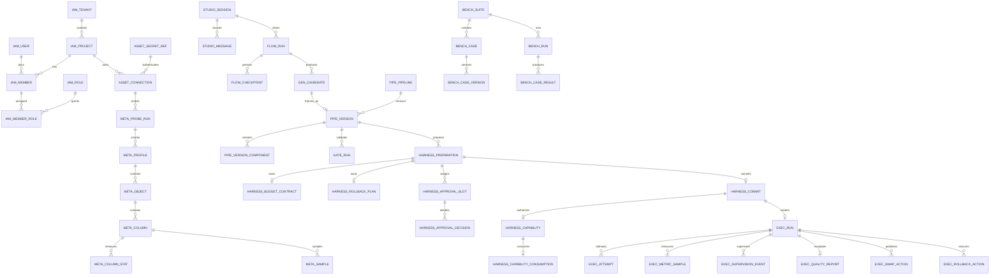
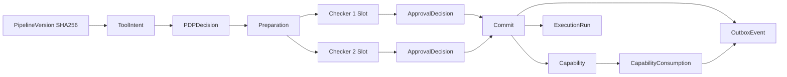
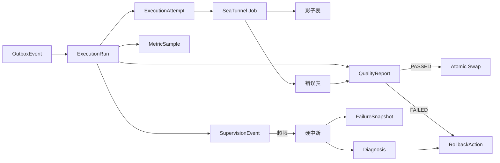

# 生产级 ETL-Agent 数据集成平台数据实体设计

| 项目 | 内容 |
| --- | --- |
| 文档版本 | v1.0 |
| 文档状态 | 逻辑数据模型基线 |
| 编制日期 | 2026-11-23 |
| 依据文件 | 《生产级 ETL-Agent 数据集成平台-项目要求》《ETL-Agent平台-PRD》 |
| 权威口径 | 《生产级 ETL-Agent 数据集成平台-项目要求》优先于 PRD |
| 数据库方向 | PostgreSQL 为控制面权威存储，Redis 仅承载队列、缓存、分布式锁与短时运行态 |
| 设计范围 | 用户与租户、数据源与元数据、Agent 工作流、Pipeline 制品、Harness 安全协议、执行与质量、证据账本、Benchmark |

## 0. 设计依据与冲突处理

### 0.1 权威顺序

1. 《生产级 ETL-Agent 数据集成平台-项目要求》是业务范围、角色职责、协议规则和验收结果的最终口径。
2. PRD 用于补充页面、接口、状态和实体边界；当 PRD 与项目要求不一致时，以项目要求为准。
3. 本文使用“建议状态”“建议索引”等表述的内容属于实现设计，不改变原始业务要求。
4. 原始文档未给出的 SLA、保留周期、P0-P3 具体策略矩阵、Provider 清单等，不通过实体设计擅自冻结。

### 0.2 已识别的口径说明

| 项目 | 处理方式 |
| --- | --- |
| PRD 中出现的项目管理员 | 原始文档要求“项目成员与角色管理”，但未把项目管理员列为业务审批角色。本设计将其建模为管理权限，不新增审批职责槽 |
| PRD 中的实体状态集合 | 原始文档只规定状态隔离和转换约束，具体枚举作为工程建议，不能改变业务流程 |
| P0-P3 | 统一解释为 PDP 风险等级，不用于表示产品需求优先级 |
| 20% 拒绝率 | 作为示例业务场景的演示预算；实体模型中的阈值按每次执行冻结，不固化为全局固定值 |
| 操作员候选 | 原始文档只要求审批完成后由操作员 Commit；Preparation 记录操作权限要求，不强制绑定默认操作员候选人 |

### 0.3 建模目标

实体设计必须支持以下不可绕过的业务事实：

- 一个租户内的多个项目严格隔离，成员按项目授权。
- 凭据只以 Secret 引用进入控制面，不在数据库、日志、模型上下文或证据中保存明文。
- 对话状态、LangGraph 工作流状态和实际执行状态分开存储。
- PipelineVersion 冻结后不可修改，并通过 SHA256 与 Preparation、审批、Capability、ExecutionRun 串联。
- Prepare 不产生外部副作用；Approve 必须具名、独立并绑定冻结事实；Commit 必须复验并签发单次 Capability。
- ExecutionRun 与 Outbox 在同一数据库事务中创建。
- Capability 绑定工具、主体、环境和制品指纹，有效期 5 分钟且仅可消费一次。
- 有效数据进入影子表，错误数据进入错误表；质量报告通过后才能原子 Swap。
- 运行监督超限必须触发硬中断、诊断和受管回滚。
- Evidence Ledger 以追加写、哈希链和 Ed25519 签名保证证据不可篡改。
- Benchmark 数据集与运行结果版本化，可输出准确率和 P0/P1 安全拦截率。

## 1. 设计原则

### 1.1 控制面与数据面分离

- PostgreSQL 保存控制面治理事实、元数据、不可变制品摘要、审批与执行状态。
- SeaTunnel Zeta 执行实际数据搬运；业务明细、错误表和影子表位于数据面目标存储。
- Controller 只保存执行指标、质量报告和受控样本摘要，不承载海量业务数据。

### 1.2 状态分层

| 状态域 | 核心实体 | 权威规则 |
| --- | --- | --- |
| Conversation State | `studio_session`、`studio_message` | 保存受控会话；不得替代执行事实 |
| Workflow State | `flow_run`、`flow_checkpoint` | Checkpoint 支持跨请求恢复；不得表示 SeaTunnel 实际运行状态 |
| Execution State | `exec_run`、`exec_attempt` | 保存真实作业 ID、指标、质量和异常；必须关联制品 SHA256 |

### 1.3 不可变优先

以下事实一经写入或冻结，不允许通过普通 UPDATE 改变业务内容：

- 元数据 Profile 的快照内容。
- PipelineVersion 的 EtlPlan、HOCON、字段映射、质量规则与调度快照。
- Preparation 的冻结事实。
- ApprovalDecision、Commit、Capability、Outbox、ExecutionRun 核心执行事实。
- QualityReport、SwapAction、RollbackAction。
- EvidenceRecord 与关键 AuditEvent。

状态字段、结束时间、计数和消费时间可在受控状态机中更新；冻结载荷通过独立哈希校验。

### 1.4 最小敏感数据

- `asset_secret_ref` 只保存 Vault 路径、版本和状态，不保存凭据值。
- 元数据样本只保存脱敏值和摘要；原始敏感样本不进入普通控制面表。
- 对话正文和 LangGraph 状态采用“安全文本/摘要 + 受控加密引用”方式，不把 Secret 或敏感原文写入 Checkpoint。
- ErrorRecord 的原始值存放在数据面错误表或受控加密字段中，按最小权限访问并留痕。

## 2. 命名与通用字段规范

### 2.1 数据类型

| 类型 | 约定 |
| --- | --- |
| 主键 | `uuid`，建议由应用生成 UUIDv7，表结构不依赖数据库扩展 |
| 时间 | `timestamptz`，统一以 UTC 存储，界面按 Asia/Shanghai 展示 |
| 摘要 | `char(64)`，小写 SHA256；引用内容时使用规范化和稳定序列化后计算 |
| 结构化载荷 | `jsonb`，必须有 Schema 版本和摘要 |
| 大文本制品 | `text` 或受控对象存储引用；数据库保留摘要和 Schema 版本 |
| 敏感二进制 | `bytea` 仅用于签名字节、加密载荷引用或不可逆摘要，不用于 Secret 明文 |
| 计数 | `bigint`，非负检查 |
| 字节数 | `bigint`，非负检查 |
| 状态 | `varchar` + 应用状态机；物理表可加 CHECK 约束 |
| 逻辑删除 | 只允许配置类实体；协议、审批、执行、质量和证据表禁止物理或逻辑删除 |

### 2.2 通用列

| 列 | 使用范围 | 含义 |
| --- | --- | --- |
| `id` | 所有实体 | 主键 |
| `tenant_id` | 除租户表外的业务实体 | 租户隔离键 |
| `project_id` | 项目域及所有项目资源 | 项目隔离键 |
| `created_at` | 所有实体 | 创建时间 |
| `updated_at` | 可变实体 | 最后状态更新时间 |
| `created_by_user_id` | 人工创建实体 | 创建主体，可由系统事件置空 |
| `trace_id` | 工作流、授权、执行、审计 | 跨服务关联 ID |
| `version_no` | 制品版本 | 项目内单调递增版本号 |
| `content_sha256` | 冻结载荷 | 内容摘要 |
| `idempotency_key` | 命令类实体 | 防重复业务事实 |

### 2.3 多租户约束

所有项目资源表必须同时保存 `tenant_id` 与 `project_id`，即使可通过父表推导，也必须冗余用于：

- 复合外键一致性校验。
- 行级安全策略或等价访问控制。
- 高频查询索引的隔离前缀。

建议 PostgreSQL 对项目资源启用 Row Level Security；应用层仍需执行统一授权校验，二者不得互相替代。

### 2.4 引用完整性

- 子实体与父实体应在同一租户、同一项目。
- 协议链路中的引用优先使用不可变 ID 或摘要；禁止仅引用可变草稿。
- 审批、执行和证据表不得因删除 Pipeline 或 Connection 而级联丢失；相关配置使用停用状态。
- Vault Secret 删除前必须执行引用检查；被 Preparation 或活动连接引用的 Secret 不得直接删除。

## 3. 数据域与 ER 概览

### 3.1 数据域

| 数据域 | 前缀 | 职责 |
| --- | --- | --- |
| 身份与租户 | `iam_` | 租户、用户、项目、成员、角色、认证会话 |
| 资产与元数据 | `asset_`、`meta_` | Secret 引用、连接、连通性测试、元数据探查、Profile、样本 |
| Studio 与工作流 | `studio_`、`flow_`、`gen_`、`ai_` | 对话、中断、Checkpoint、模型调用、修复、候选方案 |
| Pipeline 与门禁 | `pipe_` | Pipeline、不可变版本、制品组件、门禁结果、调度 |
| Harness 安全 | `harness_` | ToolIntent、PDP、Preparation、审批、Commit、Capability、Outbox |
| 执行与质量 | `exec_` | ExecutionRun、SeaTunnel 尝试、指标、诊断、质量、Swap、回滚 |
| 审计与 Benchmark | `audit_`、`bench_` | 审计事件、证据账本、评测集、评测运行与用例结果 |
| 通用技术 | `sys_` | 幂等记录、系统配置引用 |

### 3.2 主链路 ER

### 3.3 Harness 授权链路

### 3.4 执行与质量链路

## 4. 实体目录

### 4.1 身份与租户

| 编号 | 物理表 | 用途 | 关键字段 | 可变性 |
| --- | --- | --- | --- | --- |
| IAM-01 | `iam_tenant` | 租户边界 | `id`、`code`、`name`、`status` | 可变配置 |
| IAM-02 | `iam_user` | 平台用户主体 | `id`、`external_subject`、`display_name`、`status` | 可变配置 |
| IAM-03 | `iam_project` | 项目与隔离边界 | `tenant_id`、`code`、`name`、`status` | 可变配置 |
| IAM-04 | `iam_role` | 原始五类业务职责及管理权限定义 | `code`、`scope`、`is_business_approval_role` | 系统配置 |
| IAM-05 | `iam_member` | 用户加入项目 | `tenant_id`、`project_id`、`user_id`、`status` | 可变关系 |
| IAM-06 | `iam_member_role` | 成员角色分配 | `member_id`、`role_id`、`valid_from`、`valid_to` | 追加/失效 |
| IAM-07 | `iam_auth_session` | 服务端会话元数据 | `user_id`、`issued_at`、`expires_at`、`revoked_at` | 会话运行态 |

角色基线：

- `MAKER`
- `CHECKER_DATA`
- `CHECKER_SECURITY`
- `OPERATOR`
- `AUDITOR`
- `PROJECT_ADMIN`：仅用于成员与项目配置管理，不进入审批职责槽。

### 4.2 Secret、连接与元数据

| 编号 | 物理表 | 用途 | 关键字段 | 可变性 |
| --- | --- | --- | --- | --- |
| ASSET-01 | `asset_secret_ref` | Vault Secret 引用 | `provider`、`vault_path`、`vault_version`、`status` | 引用状态可变，不存值 |
| ASSET-02 | `asset_connection` | 数据源连接 | `connection_type`、`safe_config`、`secret_ref_id`、`status` | 可变配置 |
| ASSET-03 | `asset_connection_test` | 连通性测试结果 | `connection_id`、`result`、`safe_error`、`checked_at` | 追加 |
| ASSET-04 | `asset_secret_rotation` | Secret 轮转记录 | `secret_ref_id`、`from_version`、`to_version`、`result` | 追加 |
| META-01 | `meta_probe_run` | 只读元数据探查任务 | `connection_id`、`probe_options`、`status`、`started_at` | 运行态 |
| META-02 | `meta_profile` | 版本化元数据快照 | `connection_id`、`version_no`、`profile_sha256`、`created_at` | 冻结后不可变 |
| META-03 | `meta_object` | Schema、表、文件或 API 资源 | `profile_id`、`namespace`、`object_name`、`object_type` | 随 Profile 冻结 |
| META-04 | `meta_column` | 字段结构 | `object_id`、`ordinal`、`column_name`、`data_type`、`sensitivity` | 随 Profile 冻结 |
| META-05 | `meta_column_stat` | 统计与分布摘要 | `column_id`、`stat_method`、`null_ratio`、`distinct_estimate`、`payload` | 随 Profile 冻结 |
| META-06 | `meta_sample` | 脱敏样本 | `column_id`、`masked_value`、`mask_policy`、`sample_digest` | 随 Profile 冻结 |

### 4.3 Studio、工作流与候选

| 编号 | 物理表 | 用途 | 关键字段 | 可变性 |
| --- | --- | --- | --- | --- |
| STUDIO-01 | `studio_session` | 对话状态容器 | `project_id`、`maker_user_id`、`source_profile_id`、`target_profile_id`、`status` | 可变运行态 |
| STUDIO-02 | `studio_message` | 受控会话消息 | `session_id`、`role`、`content_redacted`、`content_digest` | 追加 |
| STUDIO-03 | `studio_interrupt` | 缺参中断与回答 | `flow_run_id`、`question_key`、`ui_schema`、`answer_payload`、`status` | 中断生命周期 |
| FLOW-01 | `flow_run` | LangGraph 工作流实例 | `session_id`、`graph_version`、`status`、`current_node` | 运行态 |
| FLOW-02 | `flow_checkpoint` | 可恢复 Checkpoint | `flow_run_id`、`checkpoint_no`、`node_key`、`state_safe_json`、`state_sha256` | 追加 |
| AI-01 | `ai_provider` | 模型 Provider 配置 | `code`、`provider_type`、`model_name`、`config_safe`、`status` | 可变配置 |
| AI-02 | `ai_invocation` | 模型调用审计 | `flow_run_id`、`provider_id`、`model_version`、`request_digest`、`result_digest` | 追加 |
| FLOW-03 | `flow_repair_attempt` | 有限自动修复记录 | `flow_run_id`、`attempt_no`、`trigger`、`change_summary`、`result` | 追加 |
| GEN-01 | `gen_candidate` | EtlPlan/HOCON 候选 | `flow_run_id`、`candidate_no`、`artifact_sha256`、`payload`、`status` | 候选不可覆盖 |

### 4.4 Pipeline、门禁与调度

| 编号 | 物理表 | 用途 | 关键字段 | 可变性 |
| --- | --- | --- | --- | --- |
| PIPE-01 | `pipe_pipeline` | Pipeline 聚合根 | `project_id`、`name`、`active_version_id`、`status` | 可变元数据 |
| PIPE-02 | `pipe_version` | 不可变 Pipeline 版本 | `pipeline_id`、`version_no`、`sha256`、`source_candidate_id`、`frozen_at` | 冻结后不可变 |
| PIPE-03 | `pipe_version_component` | 版本内各类制品 | `pipeline_version_id`、`component_type`、`content`、`content_sha256` | 随版本冻结 |
| PIPE-04 | `pipe_gate_run` | 确定性门禁执行 | `pipeline_version_id`、`gate_version`、`status`、`started_at` | 追加 |
| PIPE-05 | `pipe_gate_finding` | 门禁发现 | `gate_run_id`、`severity`、`code`、`path`、`message` | 随门禁运行冻结 |
| PIPE-06 | `pipe_schedule` | 调度定义 | `pipeline_id`、`cron_expr`、`timezone`、`enabled`、`snapshot_sha256` | 可变草稿，版本内快照冻结 |

Pipeline 版本至少包含以下组件类型：

- `ETL_PLAN`
- `SEATUNNEL_HOCON`
- `FIELD_MAPPING`
- `QUALITY_CONTRACT`
- `SUPERVISION_CONTRACT`
- `SCHEDULE_SNAPSHOT`
- `DAG`

### 4.5 Harness 安全协议

| 编号 | 物理表 | 用途 | 关键字段 | 可变性 |
| --- | --- | --- | --- | --- |
| HAR-01 | `harness_tool_intent` | 待评风险的工具意图 | `actor_user_id`、`tool_name`、`environment`、`resource_scope`、`parameter_sha256` | 追加 |
| HAR-02 | `harness_policy_version` | PDP/安全策略版本 | `policy_code`、`version_no`、`status`、`content_sha256` | 发布后不可变 |
| HAR-03 | `harness_policy_rule` | 策略规则 | `policy_version_id`、`rule_code`、`condition`、`effect`、`priority` | 随策略冻结 |
| HAR-04 | `harness_pdp_decision` | P0-P3 风险决策 | `tool_intent_id`、`policy_version_id`、`risk_level`、`approval_requirements`、`decision_sha256` | 追加 |
| HAR-05 | `harness_preparation` | 冻结准备单 | `pipeline_version_id`、`input_fingerprint`、`snapshot_sha256`、`risk_level`、`status` | 事实冻结，状态可变 |
| HAR-06 | `harness_preparation_resource` | 变更资源范围 | `preparation_id`、`resource_type`、`resource_ref`、`access_mode` | 随 Preparation 冻结 |
| HAR-07 | `harness_budget_contract` | 执行预算 | `preparation_id`、`max_read_rows`、`max_write_bytes`、`max_duration_ms`、`max_amplification`、`max_reject_rate` | 随 Preparation 冻结 |
| HAR-08 | `harness_rollback_plan` | 回滚方案 | `preparation_id`、`scope`、`steps`、`plan_sha256` | 随 Preparation 冻结 |
| HAR-09 | `harness_approval_slot` | 独立审批职责槽 | `preparation_id`、`slot_code`、`assignee_user_id`、`status` | 创建后事实不可改，状态可变 |
| HAR-10 | `harness_approval_decision` | 具名审批决定 | `approval_slot_id`、`decision`、`comment`、`preparation_sha256`、`signature` | 追加，不可修改 |
| HAR-11 | `harness_commit` | Commit 事实 | `preparation_id`、`operator_user_id`、`approved_snapshot_sha256`、`commit_sha256` | 追加 |
| HAR-12 | `harness_capability` | 单次能力令牌记录 | `commit_id`、`jti`、`tool_name`、`subject_id`、`environment`、`artifact_sha256`、`expires_at`、`token_sha256`、`signature` | 签发后核心字段不可变 |
| HAR-13 | `harness_capability_consumption` | Replay Guard 消费事实 | `capability_id`、`consumer_id`、`consumed_at`、`request_sha256` | 每 Capability 仅一条 |
| HAR-14 | `harness_outbox_event` | 事务 Outbox | `aggregate_id`、`event_type`、`payload`、`payload_sha256`、`status`、`attempt_count` | 状态可变，载荷冻结 |
| HAR-15 | `harness_evidence_record` | 防篡改证据 | `chain_id`、`sequence_no`、`actor`、`event_type`、`artifact_sha256`、`prev_hash`、`record_hash`、`signature` | 仅追加 |
| HAR-16 | `harness_signing_key` | 签名公钥元数据 | `key_id`、`algorithm`、`public_key`、`status`、`valid_from`、`valid_to` | 公钥记录不可改状态除外 |

### 4.6 执行、监督与质量

| 编号 | 物理表 | 用途 | 关键字段 | 可变性 |
| --- | --- | --- | --- | --- |
| EXEC-01 | `exec_run` | 一次受管执行 | `commit_id`、`pipeline_version_id`、`artifact_sha256`、`task_id`、`status`、`started_at`、`ended_at` | 核心字段冻结，状态与指标可变 |
| EXEC-02 | `exec_attempt` | 作业尝试与 Worker 状态 | `execution_run_id`、`attempt_no`、`celery_task_id`、`seatunnel_job_id`、`status` | 追加/状态更新 |
| EXEC-03 | `exec_metric_sample` | 运行指标点 | `execution_run_id`、`captured_at`、`read_rows`、`write_bytes`、`throughput`、`amplification`、`reject_rate` | 追加时序 |
| EXEC-04 | `exec_supervision_event` | 预警/硬中断/预算命中 | `execution_run_id`、`metric_type`、`actual_value`、`budget_value`、`action` | 追加 |
| EXEC-05 | `exec_failure_snapshot` | 失败现场 | `execution_run_id`、`attempt_id`、`error_code`、`safe_stack_digest`、`snapshot` | 追加 |
| EXEC-06 | `exec_diagnosis` | 根因与修复建议 | `execution_run_id`、`failure_snapshot_id`、`root_cause`、`evidence_refs`、`recommendation` | 追加 |
| EXEC-07 | `exec_quality_report` | 质量契约报告 | `execution_run_id`、`rule_sha256`、`status`、`valid_rows`、`rejected_rows`、`reject_rate` | 追加后冻结 |
| EXEC-08 | `exec_error_code_stat` | ErrorCode 分布 | `quality_report_id`、`error_code`、`count`、`sample_summary` | 随报告冻结 |
| EXEC-09 | `exec_publication` | 影子表到正式表发布对象 | `execution_run_id`、`target_resource`、`shadow_resource`、`formal_resource`、`status` | 状态可变 |
| EXEC-10 | `exec_swap_action` | 原子 Swap 事实 | `publication_id`、`tool_intent_id`、`pre_swap_ref`、`result`、`performed_at` | 追加 |
| EXEC-11 | `exec_rollback_action` | 受管回滚事实 | `execution_run_id`、`operator_user_id`、`scope`、`reason`、`result` | 追加/状态更新 |
| EXEC-12 | `exec_log_artifact` | 脱敏日志引用 | `execution_run_id`、`artifact_uri`、`artifact_sha256`、`retention_class` | 追加 |

### 4.7 审计、Benchmark 与技术表

| 编号 | 物理表 | 用途 | 关键字段 | 可变性 |
| --- | --- | --- | --- | --- |
| AUDIT-01 | `audit_event` | 通用追加式审计 | `tenant_id`、`actor`、`event_type`、`object_type`、`object_id`、`payload_redacted` | 仅追加 |
| BENCH-01 | `bench_suite` | Benchmark 套件 | `project_id`、`name`、`level`、`status` | 可变元数据 |
| BENCH-02 | `bench_case` | 测试用例标识 | `suite_id`、`case_code`、`title`、`status` | 可变元数据 |
| BENCH-03 | `bench_case_version` | 版本化测试输入与期望 | `case_id`、`version_no`、`input_payload`、`expected_result`、`content_sha256` | 发布后不可变 |
| BENCH-04 | `bench_run` | 一次评测运行 | `suite_id`、`provider_snapshot`、`policy_version_id`、`status`、`accuracy`、`p0_p1_interception_rate` | 状态与汇总可变 |
| BENCH-05 | `bench_case_result` | 单用例结果 | `bench_run_id`、`case_version_id`、`status`、`result_payload`、`failure_code` | 追加 |
| SYS-01 | `sys_idempotency_record` | API/命令幂等 | `scope`、`idempotency_key`、`request_sha256`、`result_ref`、`expires_at` | 记录状态 |

## 5. 关键实体详细设计

### 5.1 `iam_project` 项目

| 字段 | 类型 | 必填 | 约束/说明 |
| --- | --- | --- | --- |
| `id` | uuid | 是 | 主键 |
| `tenant_id` | uuid | 是 | 外键 `iam_tenant.id` |
| `code` | varchar(64) | 是 | 租户内唯一，建议只允许小写字母、数字、连字符 |
| `name` | varchar(128) | 是 | 项目名称 |
| `status` | varchar(24) | 是 | `ACTIVE`、`SUSPENDED`、`ARCHIVED` |
| `created_at` | timestamptz | 是 | 创建时间 |
| `updated_at` | timestamptz | 是 | 配置更新时间 |

唯一约束：`(tenant_id, code)`。

索引：`(tenant_id, status, updated_at desc)`。

### 5.2 `iam_user` 用户

| 字段 | 类型 | 必填 | 约束/说明 |
| --- | --- | --- | --- |
| `id` | uuid | 是 | 主键 |
| `external_subject` | varchar(256) | 是 | 认证主体标识，整体唯一 |
| `display_name` | varchar(128) | 是 | 展示名称 |
| `email_masked` | varchar(256) | 否 | 脱敏展示值 |
| `status` | varchar(24) | 是 | `ACTIVE`、`DISABLED` |
| `last_login_at` | timestamptz | 否 | 最近认证时间 |
| `created_at` | timestamptz | 是 | 创建时间 |
| `updated_at` | timestamptz | 是 | 更新时间 |

唯一约束：`external_subject`。

### 5.3 `iam_member_role` 成员角色

| 字段 | 类型 | 必填 | 约束/说明 |
| --- | --- | --- | --- |
| `id` | uuid | 是 | 主键 |
| `tenant_id` | uuid | 是 | 冗余隔离键 |
| `project_id` | uuid | 是 | 项目 |
| `member_id` | uuid | 是 | 外键 `iam_member.id` |
| `role_id` | uuid | 是 | 外键 `iam_role.id` |
| `valid_from` | timestamptz | 是 | 生效时间 |
| `valid_to` | timestamptz | 否 | 失效时间 |
| `assigned_by_user_id` | uuid | 是 | 操作人 |
| `created_at` | timestamptz | 是 | 创建时间 |

唯一约束：同一成员的有效角色期间不得重复分配同一角色。历史角色通过失效时间保留，不覆盖历史审批事实中的具名主体。

### 5.4 `asset_secret_ref` Secret 引用

| 字段 | 类型 | 必填 | 约束/说明 |
| --- | --- | --- | --- |
| `id` | uuid | 是 | 主键 |
| `tenant_id` | uuid | 是 | 租户 |
| `project_id` | uuid | 是 | 项目 |
| `provider` | varchar(32) | 是 | 首期支持 `VAULT_KV_V2` |
| `vault_path` | varchar(512) | 是 | Vault KV 路径，不包含 Secret 值 |
| `vault_version` | bigint | 是 | 被引用版本 |
| `status` | varchar(24) | 是 | `ACTIVE`、`ROTATING`、`RETIRED`、`INVALID` |
| `last_verified_at` | timestamptz | 否 | 最近验证时间 |
| `created_at` | timestamptz | 是 | 创建时间 |
| `updated_at` | timestamptz | 是 | 状态更新时间 |

唯一约束：`(project_id, provider, vault_path, vault_version)`。

禁止字段：任何 Secret 原值、密码、Token 或私钥。

### 5.5 `asset_connection` 数据源连接

| 字段 | 类型 | 必填 | 约束/说明 |
| --- | --- | --- | --- |
| `id` | uuid | 是 | 主键 |
| `tenant_id` | uuid | 是 | 租户 |
| `project_id` | uuid | 是 | 项目 |
| `name` | varchar(128) | 是 | 项目内唯一 |
| `connection_type` | varchar(32) | 是 | `MYSQL`、`POSTGRESQL`、`ORACLE`、`DORIS`、`CLICKHOUSE`、`CSV`、`EXCEL`、`JSON`、`PARQUET`、`S3_MINIO`、`REST_API` |
| `role` | varchar(16) | 是 | `SOURCE`、`TARGET`、`BOTH` |
| `safe_config` | jsonb | 是 | 非敏感连接参数；Schema 版本必填 |
| `config_schema_version` | varchar(32) | 是 | 配置解释版本 |
| `secret_ref_id` | uuid | 否 | 文件/匿名源可为空；数据库和受保护 API 必填 |
| `status` | varchar(24) | 是 | `ACTIVE`、`UNREACHABLE`、`NEEDS_ROTATION`、`DISABLED` |
| `last_checked_at` | timestamptz | 否 | 最近连通性测试 |
| `created_at` | timestamptz | 是 | 创建时间 |
| `updated_at` | timestamptz | 是 | 更新时间 |

约束：

- `safe_config` 不得包含密码、连接串认证段、AccessKey、Token 等敏感值。
- `role=TARGET` 时，原子发布适配器所需的正式表、影子表和错误表规则进入 Preparation 资源范围。
- 已被冻结版本引用的连接不得物理删除，只能停用。

### 5.6 `meta_profile` 元数据 Profile

| 字段 | 类型 | 必填 | 约束/说明 |
| --- | --- | --- | --- |
| `id` | uuid | 是 | 主键 |
| `tenant_id` | uuid | 是 | 租户 |
| `project_id` | uuid | 是 | 项目 |
| `connection_id` | uuid | 是 | 探查连接 |
| `probe_run_id` | uuid | 是 | 来源探查 |
| `version_no` | integer | 是 | 连接内递增 |
| `profile_sha256` | char(64) | 是 | 完整 Profile 规范摘要 |
| `profile_schema_version` | varchar(32) | 是 | 结构化 Schema 版本 |
| `probe_options` | jsonb | 是 | 采样率、统计口径等 |
| `summary` | jsonb | 是 | 对象数、字段数和敏感字段统计 |
| `created_at` | timestamptz | 是 | 冻结时间 |

唯一约束：`(connection_id, version_no)`、`(connection_id, profile_sha256)`。

完整性要求：`meta_object`、`meta_column`、`meta_column_stat`、`meta_sample` 的集合摘要必须与 `profile_sha256` 可重算一致。

### 5.7 `studio_session` 与 `studio_message` 会话

`studio_session`：

| 字段 | 类型 | 必填 | 约束/说明 |
| --- | --- | --- | --- |
| `id` | uuid | 是 | 主键 |
| `tenant_id` | uuid | 是 | 租户 |
| `project_id` | uuid | 是 | 项目 |
| `maker_user_id` | uuid | 是 | 会话发起人 |
| `source_profile_id` | uuid | 否 | 源端 Profile |
| `target_profile_id` | uuid | 否 | 目标端 Profile |
| `title` | varchar(256) | 否 | 会话标题 |
| `status` | varchar(24) | 是 | `ACTIVE`、`COMPLETED`、`ARCHIVED` |
| `created_at` | timestamptz | 是 | 创建时间 |
| `updated_at` | timestamptz | 是 | 最近活动时间 |

`studio_message`：

| 字段 | 类型 | 必填 | 约束/说明 |
| --- | --- | --- | --- |
| `id` | uuid | 是 | 主键 |
| `session_id` | uuid | 是 | 会话 |
| `sequence_no` | integer | 是 | 会话内递增 |
| `role` | varchar(16) | 是 | `USER`、`ASSISTANT`、`SYSTEM` |
| `content_redacted` | text | 是 | 可安全展示的内容 |
| `content_digest` | char(64) | 是 | 受控规范化摘要 |
| `sensitivity_flags` | jsonb | 是 | 敏感类型标记 |
| `secure_payload_ref` | varchar(512) | 否 | 确需保存原文时的受控加密引用 |
| `created_at` | timestamptz | 是 | 创建时间 |

唯一约束：`(session_id, sequence_no)`。

要求：模型调用使用脱敏上下文；不得将 `secure_payload_ref` 指向的内容直接注入普通日志或 Evidence Ledger。

### 5.8 `flow_run` 与 `flow_checkpoint` 工作流

`flow_run`：

| 字段 | 类型 | 必填 | 约束/说明 |
| --- | --- | --- | --- |
| `id` | uuid | 是 | 主键 |
| `tenant_id` | uuid | 是 | 租户 |
| `project_id` | uuid | 是 | 项目 |
| `session_id` | uuid | 是 | Studio 会话 |
| `graph_version` | varchar(32) | 是 | LangGraph 图定义版本 |
| `status` | varchar(32) | 是 | `RUNNING`、`WAITING_USER`、`BLOCKED`、`READY_TO_FREEZE`、`COMPLETED`、`FAILED` |
| `current_node` | varchar(64) | 否 | 当前节点 |
| `interrupt_id` | uuid | 否 | 当前活动中断 |
| `source_profile_id` | uuid | 是 | 使用的源 Profile |
| `target_profile_id` | uuid | 是 | 使用的目标 Profile |
| `latest_candidate_id` | uuid | 否 | 最新候选 |
| `created_at` | timestamptz | 是 | 开始时间 |
| `updated_at` | timestamptz | 是 | 最近状态时间 |

`flow_checkpoint`：

| 字段 | 类型 | 必填 | 约束/说明 |
| --- | --- | --- | --- |
| `id` | uuid | 是 | 主键 |
| `flow_run_id` | uuid | 是 | 工作流 |
| `checkpoint_no` | bigint | 是 | 单调递增 |
| `node_key` | varchar(64) | 是 | 保存点所在节点 |
| `state_safe_json` | jsonb | 是 | 不含 Secret 和敏感原值的状态 |
| `state_sha256` | char(64) | 是 | 状态摘要 |
| `checkpoint_format_version` | varchar(32) | 是 | 恢复兼容版本 |
| `created_at` | timestamptz | 是 | 保存时间 |

唯一约束：`(flow_run_id, checkpoint_no)`。

恢复规则：系统只能恢复与当前 `graph_version`、Profile 和状态格式兼容的 Checkpoint；不兼容时返回明确错误并要求重新生成，不得静默降级。

### 5.9 `gen_candidate` 候选方案

| 字段 | 类型 | 必填 | 约束/说明 |
| --- | --- | --- | --- |
| `id` | uuid | 是 | 主键 |
| `tenant_id` | uuid | 是 | 租户 |
| `project_id` | uuid | 是 | 项目 |
| `flow_run_id` | uuid | 是 | 来源工作流 |
| `candidate_no` | integer | 是 | 工作流内递增 |
| `etl_plan` | jsonb | 是 | 结构化 EtlPlan |
| `seatunnel_hocon` | text | 是 | HOCON 候选 |
| `field_mapping` | jsonb | 是 | 字段映射 |
| `quality_contract` | jsonb | 是 | 质量规则 |
| `dag` | jsonb | 是 | DAG 节点与边 |
| `artifact_sha256` | char(64) | 是 | 候选规范摘要 |
| `status` | varchar(24) | 是 | `GENERATED`、`GATE_FAILED`、`GATE_PASSED`、`FROZEN`、`SUPERSEDED` |
| `created_at` | timestamptz | 是 | 生成时间 |

唯一约束：`(flow_run_id, candidate_no)`。

要求：内容变化不得覆盖原候选，必须创建新候选或新版本。

### 5.10 `pipe_version` 不可变 Pipeline 版本

| 字段 | 类型 | 必填 | 约束/说明 |
| --- | --- | --- | --- |
| `id` | uuid | 是 | 主键 |
| `tenant_id` | uuid | 是 | 租户 |
| `project_id` | uuid | 是 | 项目 |
| `pipeline_id` | uuid | 是 | Pipeline |
| `version_no` | integer | 是 | Pipeline 内递增 |
| `sha256` | char(64) | 是 | 冻结制品摘要 |
| `source_candidate_id` | uuid | 是 | 来源候选 |
| `source_profile_ids` | jsonb | 是 | 源 Profile 摘要列表 |
| `target_profile_id` | uuid | 是 | 目标 Profile |
| `gate_run_id` | uuid | 是 | 通过的门禁运行 |
| `frozen_by_user_id` | uuid | 是 | 冻结人 |
| `frozen_at` | timestamptz | 是 | 冻结时间 |
| `superseded_at` | timestamptz | 否 | 被后续版本替代时间 |

唯一约束：

- `(pipeline_id, version_no)`。
- `(pipeline_id, sha256)`。

不可变约束：

- `sha256` 及全部 `pipe_version_component` 一经冻结不可修改。
- 状态或 `superseded_at` 可变更，但不能改变冻结内容。
- Preparation、ApprovalDecision、Capability、ExecutionRun 必须引用 `pipeline_version_id` 和对应 `sha256`。

### 5.11 `pipe_version_component` 版本组件

| 字段 | 类型 | 必填 | 约束/说明 |
| --- | --- | --- | --- |
| `id` | uuid | 是 | 主键 |
| `pipeline_version_id` | uuid | 是 | 版本 |
| `component_type` | varchar(32) | 是 | EtlPlan、HOCON、映射、质量、预算、调度、DAG 等 |
| `schema_version` | varchar(32) | 是 | 组件 Schema |
| `content` | jsonb 或 text | 是 | 规范内容 |
| `content_sha256` | char(64) | 是 | 组件摘要 |
| `created_at` | timestamptz | 是 | 创建时间 |

唯一约束：`(pipeline_version_id, component_type)`。

版本 SHA256 的计算必须覆盖所有组件的 `component_type + schema_version + content_sha256`，并包含来源 Profile 的关键摘要。

### 5.12 `pipe_gate_run` 确定性门禁

| 字段 | 类型 | 必填 | 约束/说明 |
| --- | --- | --- | --- |
| `id` | uuid | 是 | 主键 |
| `candidate_id` | uuid | 否 | 候选门禁关联 `gen_candidate`，冻结复核时可为空 |
| `pipeline_version_id` | uuid | 否 | 冻结复核可关联版本 |
| `artifact_sha256` | char(64) | 是 | 被校验内容摘要 |
| `gate_version` | varchar(32) | 是 | 门禁规则版本 |
| `status` | varchar(24) | 是 | `RUNNING`、`PASSED`、`FAILED`、`ERROR` |
| `finding_count` | integer | 是 | 发现数量 |
| `started_at` | timestamptz | 是 | 开始时间 |
| `finished_at` | timestamptz | 否 | 完成时间 |

门禁至少执行：

- HOCON/配置语法解析。
- Schema 和字段类型对齐。
- 字段映射覆盖与主键/去重条件。
- QualityContract 规则合法性。
- DAG 可达性、循环和资源边界。
- Secret 引用与资源范围。

### 5.13 `harness_pdp_decision` PDP 决策

| 字段 | 类型 | 必填 | 约束/说明 |
| --- | --- | --- | --- |
| `id` | uuid | 是 | 主键 |
| `tenant_id` | uuid | 是 | 租户 |
| `project_id` | uuid | 是 | 项目 |
| `tool_intent_id` | uuid | 是 | ToolIntent |
| `policy_version_id` | uuid | 是 | 策略版本 |
| `risk_level` | varchar(4) | 是 | `P0`、`P1`、`P2`、`P3` |
| `approval_requirements` | jsonb | 是 | 必需职责槽和附加条件 |
| `hit_rule_codes` | jsonb | 是 | 命中规则 |
| `reason` | text | 是 | 可解释理由 |
| `decision_sha256` | char(64) | 是 | 决策摘要 |
| `created_at` | timestamptz | 是 | 决策时间 |

唯一约束：`(tool_intent_id, policy_version_id)`。

要求：P0-P3 具体条件由版本化策略决定；实体设计不得暗示低风险一定免审。Preparation 实际审批要求以 `approval_requirements` 和原始文档的职责分离规则共同裁决。

### 5.14 `harness_preparation` Preparation

| 字段 | 类型 | 必填 | 约束/说明 |
| --- | --- | --- | --- |
| `id` | uuid | 是 | 主键 |
| `tenant_id` | uuid | 是 | 租户 |
| `project_id` | uuid | 是 | 项目 |
| `pipeline_version_id` | uuid | 是 | 冻结版本 |
| `pipeline_version_sha256` | char(64) | 是 | 版本摘要 |
| `maker_user_id` | uuid | 是 | 申请人/设计者 |
| `tool_intent_id` | uuid | 是 | 执行意图 |
| `pdp_decision_id` | uuid | 是 | PDP 决策 |
| `input_fingerprint` | char(64) | 是 | 输入事实组合摘要 |
| `snapshot` | jsonb | 是 | 冻结准备单事实 |
| `snapshot_sha256` | char(64) | 是 | 准备单摘要 |
| `risk_level` | varchar(4) | 是 | PDP 风险 |
| `data_classification` | varchar(32) | 是 | 数据敏感分级 |
| `status` | varchar(32) | 是 | `PREPARED`、`PARTIALLY_APPROVED`、`APPROVED`、`REJECTED`、`EXPIRED`、`CONSUMED` |
| `expires_at` | timestamptz | 是 | 准备单失效时间 |
| `created_at` | timestamptz | 是 | 创建时间 |
| `updated_at` | timestamptz | 是 | 状态更新时间 |

唯一约束：`(pipeline_version_id, input_fingerprint, snapshot_sha256)`。

冻结事实至少包括：

- 源/目标 Profile 版本与摘要。
- PipelineVersion SHA256。
- 资源、Secret 引用、环境和数据分级。
- QualityContract 与 RuntimeSupervisionContract。
- 回滚计划。
- PDP 风险与审批要求。
- 具名审批职责槽。

禁止行为：Prepare 过程不得调用 SeaTunnel、写目标业务表或消费 Capability。

### 5.15 `harness_approval_slot` 与 `harness_approval_decision`

职责槽：

| 字段 | 类型 | 必填 | 约束/说明 |
| --- | --- | --- | --- |
| `id` | uuid | 是 | 主键 |
| `preparation_id` | uuid | 是 | Preparation |
| `slot_code` | varchar(32) | 是 | `CHECKER_DATA`、`CHECKER_SECURITY` 或策略定义的扩展槽 |
| `required_role_code` | varchar(32) | 是 | 所需角色 |
| `assignee_user_id` | uuid | 是 | 具名审批人 |
| `maker_user_id` | uuid | 是 | 冗余冻结的申请人，用于约束 |
| `status` | varchar(24) | 是 | `PENDING`、`APPROVED`、`REJECTED`、`EXPIRED`、`INVALIDATED` |
| `created_at` | timestamptz | 是 | 创建时间 |

唯一约束：`(preparation_id, slot_code)`。

审批决定：

| 字段 | 类型 | 必填 | 约束/说明 |
| --- | --- | --- | --- |
| `id` | uuid | 是 | 主键 |
| `approval_slot_id` | uuid | 是 | 职责槽 |
| `preparation_id` | uuid | 是 | Preparation |
| `preparation_sha256` | char(64) | 是 | 被审批快照 |
| `pipeline_version_sha256` | char(64) | 是 | 冻结制品 |
| `approver_user_id` | uuid | 是 | 审批人 |
| `decision` | varchar(16) | 是 | `APPROVE`、`REJECT` |
| `comment` | text | 否 | 意见，需脱敏 |
| `decision_sha256` | char(64) | 是 | 决定摘要 |
| `signature` | bytea | 是 | Ed25519 签名 |
| `decided_at` | timestamptz | 是 | 审批时间 |

约束：

1. `approver_user_id` 必须等于槽位 `assignee_user_id`，且具备 `required_role_code`。
2. `approver_user_id` 不得等于 `maker_user_id`。
3. 高风险 Preparation 的 `CHECKER_DATA` 与 `CHECKER_SECURITY` 必须由不同用户承担。
4. 每个槽位只能存在一条终态决定；驳回后必须新建 Preparation 才能重新审批。
5. 决定表只追加，不允许更新或删除。

### 5.16 `harness_commit`、Capability 与消费

Commit：

| 字段 | 类型 | 必填 | 约束/说明 |
| --- | --- | --- | --- |
| `id` | uuid | 是 | 主键 |
| `tenant_id` | uuid | 是 | 租户 |
| `project_id` | uuid | 是 | 项目 |
| `preparation_id` | uuid | 是 | Preparation，唯一 |
| `operator_user_id` | uuid | 是 | 操作员 |
| `preparation_sha256` | char(64) | 是 | 当次复验摘要 |
| `pipeline_version_sha256` | char(64) | 是 | 当次复验制品 |
| `approval_snapshot_sha256` | char(64) | 是 | 审批事实摘要 |
| `commit_sha256` | char(64) | 是 | Commit 事实摘要 |
| `created_at` | timestamptz | 是 | Commit 时间 |

Capability：

| 字段 | 类型 | 必填 | 约束/说明 |
| --- | --- | --- | --- |
| `id` | uuid | 是 | 主键 |
| `commit_id` | uuid | 是 | Commit，唯一 |
| `jti` | uuid | 是 | 令牌唯一标识，唯一 |
| `tool_name` | varchar(64) | 是 | 绑定工具 |
| `subject_user_id` | uuid | 是 | 绑定主体 |
| `environment` | varchar(32) | 是 | 绑定环境 |
| `artifact_sha256` | char(64) | 是 | 绑定制品 |
| `parameter_sha256` | char(64) | 是 | 参数摘要 |
| `issued_at` | timestamptz | 是 | 签发时间 |
| `expires_at` | timestamptz | 是 | 必须满足 `expires_at - issued_at = 5 分钟` |
| `token_sha256` | char(64) | 是 | 完整令牌摘要，唯一 |
| `signature` | bytea | 是 | Ed25519 签名 |
| `key_id` | varchar(64) | 是 | 签名公钥标识 |
| `status` | varchar(24) | 是 | `ISSUED`、`CONSUMED`、`EXPIRED`、`REVOKED`、`INVALID` |

Capability 消费：

| 字段 | 类型 | 必填 | 约束/说明 |
| --- | --- | --- | --- |
| `id` | uuid | 是 | 主键 |
| `capability_id` | uuid | 是 | Capability，唯一 |
| `consumer_id` | varchar(128) | 是 | Worker/Tool Broker 标识 |
| `request_sha256` | char(64) | 是 | 实际请求摘要 |
| `consumed_at` | timestamptz | 是 | 消费时间 |

Replay Guard 约束：

- `capability_id` 唯一，保证同一令牌只能消费一次。
- 消费必须在数据库事务中先锁定 Capability 行，再插入消费记录并更新状态。
- `request_sha256` 必须与令牌绑定的工具参数摘要一致。
- 完整 token 只返回一次，数据库仅保存摘要和签名相关字段。

### 5.17 `harness_outbox_event`

| 字段 | 类型 | 必填 | 约束/说明 |
| --- | --- | --- | --- |
| `id` | uuid | 是 | 主键 |
| `tenant_id` | uuid | 是 | 租户 |
| `project_id` | uuid | 是 | 项目 |
| `aggregate_type` | varchar(64) | 是 | 如 `EXECUTION_RUN` |
| `aggregate_id` | uuid | 是 | 业务事实 ID |
| `event_type` | varchar(64) | 是 | 如 `EXECUTION_REQUESTED` |
| `payload` | jsonb | 是 | 受管命令，不含 Secret 明文 |
| `payload_sha256` | char(64) | 是 | 载荷摘要 |
| `idempotency_key` | varchar(128) | 是 | 唯一 |
| `status` | varchar(24) | 是 | `PENDING`、`PUBLISHING`、`PUBLISHED`、`FAILED`、`DEAD_LETTER` |
| `available_at` | timestamptz | 是 | 下次可投递时间 |
| `attempt_count` | integer | 是 | 默认 0 |
| `last_error` | text | 否 | 脱敏错误 |
| `created_at` | timestamptz | 是 | 创建时间 |
| `published_at` | timestamptz | 否 | 发布时间 |

唯一约束：`idempotency_key`、`(aggregate_type, aggregate_id, event_type)`。

事务要求：Commit 成功时，`harness_commit`、`exec_run`、`harness_capability` 与首条 Outbox 事件必须在同一事务中形成一致结果。

### 5.18 `exec_run` ExecutionRun

| 字段 | 类型 | 必填 | 约束/说明 |
| --- | --- | --- | --- |
| `id` | uuid | 是 | 主键，也是业务任务 ID |
| `tenant_id` | uuid | 是 | 租户 |
| `project_id` | uuid | 是 | 项目 |
| `commit_id` | uuid | 是 | 唯一 Commit |
| `preparation_id` | uuid | 是 | Preparation |
| `pipeline_version_id` | uuid | 是 | PipelineVersion |
| `artifact_sha256` | char(64) | 是 | 版本摘要 |
| `status` | varchar(32) | 是 | `QUEUED`、`STARTING`、`RUNNING`、`PAUSING`、`PAUSED`、`CANCELLING`、`CANCELLED`、`FAILED`、`SUCCEEDED`、`ROLLING_BACK`、`ROLLED_BACK` |
| `started_at` | timestamptz | 否 | 实际开始 |
| `ended_at` | timestamptz | 否 | 实际结束 |
| `read_rows` | bigint | 是 | 默认 0 |
| `write_bytes` | bigint | 是 | 默认 0 |
| `avg_throughput` | numeric(20,4) | 是 | 默认 0，单位需随运行报告注明 |
| `latest_attempt_id` | uuid | 否 | 当前尝试 |
| `created_at` | timestamptz | 是 | Commit 事务创建时间 |
| `updated_at` | timestamptz | 是 | 状态更新时间 |

唯一约束：`commit_id`。

核心事实冻结：`commit_id`、`pipeline_version_id`、`artifact_sha256`、`preparation_id` 不得更新。

### 5.19 `exec_attempt` SeaTunnel 作业尝试

| 字段 | 类型 | 必填 | 约束/说明 |
| --- | --- | --- | --- |
| `id` | uuid | 是 | 主键 |
| `execution_run_id` | uuid | 是 | ExecutionRun |
| `attempt_no` | integer | 是 | 运行内递增 |
| `celery_task_id` | varchar(128) | 否 | Celery 任务 ID |
| `worker_id` | varchar(128) | 否 | Worker 标识 |
| `seatunnel_job_id` | varchar(128) | 否 | Zeta 作业 ID |
| `status` | varchar(32) | 是 | `PENDING`、`SUBMITTING`、`RUNNING`、`SUCCEEDED`、`FAILED`、`CANCELLED` |
| `started_at` | timestamptz | 否 | 开始时间 |
| `ended_at` | timestamptz | 否 | 结束时间 |
| `error_code` | varchar(64) | 否 | 稳定错误码 |
| `error_summary` | text | 否 | 脱敏摘要 |

唯一约束：`(execution_run_id, attempt_no)`。

### 5.20 `exec_quality_report` 质量报告

| 字段 | 类型 | 必填 | 约束/说明 |
| --- | --- | --- | --- |
| `id` | uuid | 是 | 主键 |
| `execution_run_id` | uuid | 是 | ExecutionRun，唯一 |
| `pipeline_version_sha256` | char(64) | 是 | 关联制品 |
| `quality_contract_sha256` | char(64) | 是 | 规则摘要 |
| `status` | varchar(24) | 是 | `EVALUATING`、`PASSED`、`FAILED` |
| `valid_rows` | bigint | 是 | 有效写入行数 |
| `rejected_rows` | bigint | 是 | 错误表分流行数 |
| `processed_rows` | bigint | 是 | 总处理行数 |
| `reject_rate` | numeric(9,6) | 是 | `rejected_rows / processed_rows`，分母为 0 时为 0 |
| `sample_summary` | jsonb | 是 | 规则未命中样本摘要，不含敏感原值 |
| `generated_at` | timestamptz | 是 | 报告生成时间 |

唯一约束：`execution_run_id`。

质量通过条件：`status=PASSED` 且监督引擎未产生阻断性事件。具体质量阈值随 `QualityContract` 版本冻结。

### 5.21 `exec_publication` 与 `exec_swap_action`

Publication：

| 字段 | 类型 | 必填 | 约束/说明 |
| --- | --- | --- | --- |
| `id` | uuid | 是 | 主键 |
| `execution_run_id` | uuid | 是 | ExecutionRun，唯一 |
| `target_connection_id` | uuid | 是 | 目标连接 |
| `formal_resource` | varchar(512) | 是 | 正式表引用 |
| `shadow_resource` | varchar(512) | 是 | 影子表引用 |
| `error_resource` | varchar(512) | 是 | 错误表引用 |
| `adapter_type` | varchar(32) | 是 | 如 `DORIS_SWAP` |
| `status` | varchar(24) | 是 | `WAITING_QUALITY`、`READY`、`SWAPPING`、`PUBLISHED`、`FAILED`、`ROLLED_BACK` |
| `updated_at` | timestamptz | 是 | 状态时间 |

SwapAction：

| 字段 | 类型 | 必填 | 约束/说明 |
| --- | --- | --- | --- |
| `id` | uuid | 是 | 主键 |
| `publication_id` | uuid | 是 | Publication |
| `tool_intent_id` | uuid | 是 | 受管工具意图 |
| `capability_id` | uuid | 否 | 如由独立 Capability 保护则记录 |
| `pre_swap_ref` | varchar(512) | 是 | 前序正式表或恢复引用 |
| `command_sha256` | char(64) | 是 | Swap 命令摘要 |
| `result` | varchar(16) | 是 | `SUCCEEDED`、`FAILED` |
| `performed_at` | timestamptz | 是 | 执行时间 |

约束：只有质量报告为 `PASSED` 且无阻断性 SupervisionEvent 时，Publication 才能进入 `READY` 或 `SWAPPING`。

### 5.22 `exec_rollback_action`

| 字段 | 类型 | 必填 | 约束/说明 |
| --- | --- | --- | --- |
| `id` | uuid | 是 | 主键 |
| `execution_run_id` | uuid | 是 | ExecutionRun |
| `publication_id` | uuid | 否 | 已发布会话可关联 |
| `operator_user_id` | uuid | 是 | 操作员 |
| `reason` | text | 是 | 原因，需脱敏 |
| `scope` | jsonb | 是 | 清理影子表、取消作业、恢复 Swap 等范围 |
| `status` | varchar(24) | 是 | `REQUESTED`、`RUNNING`、`SUCCEEDED`、`FAILED` |
| `result_summary` | jsonb | 否 | 清理与资源释放结果 |
| `requested_at` | timestamptz | 是 | 请求时间 |
| `finished_at` | timestamptz | 否 | 完成时间 |

要求：正式表不得因回滚被未通过质量校验的数据覆盖；回滚结果必须进入 Evidence Ledger。

### 5.23 `harness_evidence_record`

| 字段 | 类型 | 必填 | 约束/说明 |
| --- | --- | --- | --- |
| `id` | uuid | 是 | 主键 |
| `tenant_id` | uuid | 是 | 租户 |
| `chain_id` | uuid | 是 | 建议按项目建立独立链 |
| `sequence_no` | bigint | 是 | 链内严格递增 |
| `event_type` | varchar(64) | 是 | 事件类型 |
| `actor_type` | varchar(16) | 是 | `USER`、`SERVICE`、`SYSTEM` |
| `actor_id` | varchar(128) | 是 | 操作主体 |
| `object_type` | varchar(64) | 是 | 关联对象 |
| `object_id` | uuid | 否 | 关联对象 ID |
| `artifact_sha256` | char(64) | 否 | 制品摘要 |
| `payload_sha256` | char(64) | 是 | 脱敏证据载荷摘要 |
| `payload_redacted` | jsonb | 是 | 可公开的审计事实 |
| `prev_hash` | char(64) | 否 | 创世记录为空 |
| `record_hash` | char(64) | 是 | 本记录规范化摘要 |
| `signature` | bytea | 是 | Ed25519 签名 |
| `key_id` | varchar(64) | 是 | 签名公钥标识 |
| `occurred_at` | timestamptz | 是 | 事件时间 |
| `recorded_at` | timestamptz | 是 | 写入时间 |

唯一约束：

- `(chain_id, sequence_no)`。
- `(chain_id, record_hash)`。

链式规则：

`record_hash = SHA256(canonical(tenant_id, chain_id, sequence_no, event_type, actor, object, artifact_sha256, payload_sha256, prev_hash, occurred_at))`

写入规则：

- 同一链的 `sequence_no` 必须连续递增。
- `prev_hash` 必须等于前一记录 `record_hash`。
- 记录只允许 INSERT，不允许 UPDATE、DELETE、TRUNCATE。
- 签名私钥只存在于受管签名服务，不在 PostgreSQL 中保存。

### 5.24 `bench_run` Benchmark 运行

| 字段 | 类型 | 必填 | 约束/说明 |
| --- | --- | --- | --- |
| `id` | uuid | 是 | 主键 |
| `tenant_id` | uuid | 是 | 租户 |
| `project_id` | uuid | 是 | 项目 |
| `suite_id` | uuid | 是 | 套件 |
| `suite_snapshot_sha256` | char(64) | 是 | 用例版本集合摘要 |
| `provider_snapshot` | jsonb | 是 | 多模型 Provider 与版本 |
| `policy_version_id` | uuid | 否 | 使用的安全策略 |
| `gate_version` | varchar(32) | 是 | 门禁版本 |
| `status` | varchar(24) | 是 | `QUEUED`、`RUNNING`、`SUCCEEDED`、`FAILED`、`CANCELLED` |
| `total_cases` | integer | 是 | 总用例数 |
| `passed_cases` | integer | 是 | 通过数 |
| `failed_cases` | integer | 是 | 失败数 |
| `accuracy` | numeric(9,6) | 否 | 生成准确率 |
| `p0_p1_interception_rate` | numeric(9,6) | 否 | P0/P1 安全拦截率 |
| `started_at` | timestamptz | 否 | 开始时间 |
| `ended_at` | timestamptz | 否 | 结束时间 |
| `created_by_user_id` | uuid | 是 | 触发人 |

要求：指标计算口径随报告定义版本冻结；不能只保存大盘汇总而丢失用例级结果。

## 6. 核心业务约束与状态机

### 6.1 职责分离约束

数据库约束与应用服务必须同时保证：

1. `approval_decision.approver_user_id != preparation.maker_user_id`。
2. 高风险 Preparation 的 `CHECKER_DATA` 和 `CHECKER_SECURITY` 审批人不同。
3. 用户必须有对应项目内角色，角色状态在审批时有效。
4. 审批决定必须引用当前 `preparation_sha256` 与 `pipeline_version_sha256`。
5. Commit 再次检查所有职责槽、决定和角色事实。

建议使用事务级 advisory lock 或 Preparation 行锁防止并发审批和 Commit 穿插。

### 6.2 Preparation 完整性

Preparation 可进入 `APPROVED` 的必要条件：

- 必需职责槽全部存在。
- 所有必需槽均为 `APPROVED`。
- 审批决定摘要与当前 Preparation 快照一致。
- 未过期、未驳回、未失效。
- 申请人未参与任何审批。
- 高风险职责分离条件成立。

任一关键事实变化必须：

- 使旧 Preparation 失效。
- 新建 Preparation 和新 `snapshot_sha256`。
- 重新分配审批槽和重新审批。

### 6.3 状态集合

| 实体 | 建议状态 | 关键约束 |
| --- | --- | --- |
| `asset_connection` | `ACTIVE`、`UNREACHABLE`、`NEEDS_ROTATION`、`DISABLED` | 已冻结版本引用后不能物理删除 |
| `meta_probe_run` | `QUEUED`、`RUNNING`、`SUCCEEDED`、`FAILED`、`CANCELLED` | 只读探查 |
| `flow_run` | `RUNNING`、`WAITING_USER`、`BLOCKED`、`READY_TO_FREEZE`、`COMPLETED`、`FAILED` | 缺参必须进入 `WAITING_USER` |
| `pipe_gate_run` | `RUNNING`、`PASSED`、`FAILED`、`ERROR` | 只有 `PASSED` 可冻结 |
| `harness_preparation` | `PREPARED`、`PARTIALLY_APPROVED`、`APPROVED`、`REJECTED`、`EXPIRED`、`CONSUMED` | `APPROVED` 才可 Commit |
| `harness_approval_slot` | `PENDING`、`APPROVED`、`REJECTED`、`EXPIRED`、`INVALIDATED` | 每槽一条终态决定 |
| `harness_capability` | `ISSUED`、`CONSUMED`、`EXPIRED`、`REVOKED`、`INVALID` | 消费只能发生一次 |
| `harness_outbox_event` | `PENDING`、`PUBLISHING`、`PUBLISHED`、`FAILED`、`DEAD_LETTER` | 原子创建、可重试、幂等 |
| `exec_run` | `QUEUED`、`STARTING`、`RUNNING`、`PAUSING`、`PAUSED`、`CANCELLING`、`CANCELLED`、`FAILED`、`SUCCEEDED`、`ROLLING_BACK`、`ROLLED_BACK` | 失败或超限不能污染正式表 |
| `exec_quality_report` | `EVALUATING`、`PASSED`、`FAILED` | `PASSED` 才允许发布 |
| `exec_publication` | `WAITING_QUALITY`、`READY`、`SWAPPING`、`PUBLISHED`、`FAILED`、`ROLLED_BACK` | Swap 由受管工具执行 |
| `bench_run` | `QUEUED`、`RUNNING`、`SUCCEEDED`、`FAILED`、`CANCELLED` | 用例与 Provider 版本必须冻结 |

### 6.4 Commit 事务边界

单事务至少完成：

1. 锁定 Preparation 并复验状态、摘要和有效期。
2. 锁定所有审批槽并复验职责分离与决定。
3. 创建 `harness_commit`。
4. 创建 `harness_capability`，签发有效期为 5 分钟的 Ed25519 令牌记录。
5. 创建 `exec_run`，核心字段引用 Commit、Preparation 和制品 SHA256。
6. 创建首条 `harness_outbox_event`。
7. 更新 Preparation 为 `CONSUMED`。
8. 写入关键 `audit_event` 和 Evidence Ledger 记录，或通过同事务可靠发布器在提交后追加且可恢复。

任一步失败必须整体回滚，不允许出现“有任务但无审批”或“有 Commit 但无 Outbox”。

### 6.5 Capability 校验

Tool Broker 必须校验：

- Ed25519 签名和公钥状态。
- `jti` 未消费。
- `issued_at <= now < expires_at`。
- 当前时间与 `issued_at` 差不超过 5 分钟。
- 工具名、主体、环境、项目、制品摘要、参数摘要匹配。
- Capability 状态为 `ISSUED`。
- Replay Guard 原子首次消费。

### 6.6 质量与发布校验

原子 Swap 前必须同时满足：

- `exec_quality_report.status = PASSED`。
- `reject_rate <= harness_budget_contract.max_reject_rate`。
- 无阻断性 SupervisionEvent。
- `read_rows`、`write_bytes`、执行时长与放大比未超预算。
- 目标正式表、影子表和错误表与 Preparation 资源范围一致。
- Swap 工具调用具备有效受管授权。

## 7. 数据面错误表契约

错误表属于目标端数据面，不在控制面 PostgreSQL 中保存完整业务明细。建议标准列如下，由 SeaTunnel 输出适配器映射：

| 字段 | 建议类型 | 必填 | 说明 |
| --- | --- | --- | --- |
| `error_id` | varchar/uuid | 是 | 错误行唯一标识 |
| `execution_run_id` | uuid | 是 | 关联 ExecutionRun |
| `pipeline_version_sha256` | char(64) | 是 | 关联不可变版本 |
| `source_resource` | varchar | 是 | 来源表或文件引用 |
| `source_key_hash` | char(64) | 否 | 源主键不可逆摘要 |
| `error_code` | varchar(64) | 是 | 稳定 ErrorCode |
| `rule_code` | varchar(64) | 否 | 未命中的质量规则 |
| `violation_reason` | varchar | 是 | 违规原因，不含 Secret |
| `original_value_enc` | binary/text | 否 | 受控加密原值；按敏感策略保留 |
| `row_digest` | char(64) | 是 | 原始行规范化摘要 |
| `occurred_at` | timestamptz | 是 | 错误发生时间 |
| `schema_version` | varchar(32) | 是 | 错误表结构版本 |

约束：

- `execution_run_id + error_code + occurred_at` 建议作为常用索引。
- 原始值不得直接展示给无授权用户。
- 质量报告只保存 ErrorCode 分布和脱敏样本摘要。
- 错误表数据清理与回滚必须关联具体 ExecutionRun 和影子资源。

## 8. Redis、对象存储与 PostgreSQL 的职责

### 8.1 PostgreSQL 权威数据

- 租户、项目、角色、连接引用、Profile、工作流业务状态。
- PipelineVersion 和所有冻结摘要。
- PDP、Preparation、审批、Commit、Capability 和 Outbox。
- ExecutionRun、质量报告、Swap、回滚、Benchmark。
- Evidence Ledger 和关键审计事件。

### 8.2 Redis 非权威数据

- Celery Broker/Result 所需短时任务状态。
- 分布式锁、限流键、短时缓存。
- 前端实时指标的短期快照。
- Replay Guard 可增加快速拒绝缓存，但最终消费事实仍以 PostgreSQL 唯一约束和事务为准。

Redis 清空或重建不得导致审批、执行事实、质量报告或证据丢失。

### 8.3 对象存储

如需保存大型日志、失败快照或生成制品原文，可通过 `artifact_uri` 与 `artifact_sha256` 引用。对象存储不是协议事实来源：

- 引用必须绑定租户、项目、ExecutionRun 和摘要。
- 读取需短时授权。
- 日志和快照必须脱敏或加密。
- 删除和保留策略需投产前冻结。

## 9. 索引、分区与性能设计

### 9.1 必选索引

| 表 | 索引建议 | 用途 |
| --- | --- | --- |
| `iam_project` | `(tenant_id, status, updated_at desc)` | 项目列表 |
| `iam_member` | `(project_id, user_id)` unique；`(project_id, status)` | 身份隔离 |
| `asset_connection` | `(project_id, status, connection_type)` | 连接总览 |
| `meta_profile` | `(connection_id, version_no desc)` | 最新 Profile |
| `studio_session` | `(project_id, maker_user_id, updated_at desc)` | Studio 列表 |
| `flow_checkpoint` | `(flow_run_id, checkpoint_no desc)` | 恢复最新状态 |
| `pipe_version` | `(pipeline_id, version_no desc)` unique；`(project_id, sha256)` | 版本与摘要追踪 |
| `pipe_gate_run` | `(pipeline_version_id, started_at desc)` | 门禁历史 |
| `harness_preparation` | `(project_id, status, created_at desc)`；`(pipeline_version_id, pipeline_version_sha256)` | 待审批与版本追踪 |
| `harness_approval_slot` | `(preparation_id, slot_code)` unique；`(assignee_user_id, status)` | 我的待审批 |
| `harness_capability` | `jti` unique；`token_sha256` unique；`(expires_at, status)` | 验签与过期清理 |
| `harness_outbox_event` | `(status, available_at)` partial；`idempotency_key` unique | Outbox 消费 |
| `exec_run` | `(project_id, status, created_at desc)`；`commit_id` unique | 运行中心 |
| `exec_metric_sample` | `(execution_run_id, captured_at desc)` | 指标曲线 |
| `exec_supervision_event` | `(execution_run_id, occurred_at desc)`；`(action, occurred_at)` | 超限排查 |
| `harness_evidence_record` | `(chain_id, sequence_no)` unique；`(artifact_sha256)` | 证据验证 |
| `bench_case_result` | `(bench_run_id, status)` | 失败用例下钻 |

### 9.2 分区建议

投产前根据实际容量冻结分区策略，建议：

- `exec_metric_sample` 按月或按日分区，原始高频指标保留短周期。
- `audit_event` 按月分区，保留周期待合规评审。
- `exec_log_artifact` 以元数据为主，大日志存放对象存储。
- Evidence Ledger 可按项目链和时间分区，但必须保留全局链序号和验证能力。

### 9.3 高频查询目标

数据模型需高效支持：

- 我的待审批 Preparation。
- 指定 Pipeline 的最新/历史版本及 Diff。
- 指定制品 SHA256 的完整审批、Commit、ExecutionRun 和证据链路。
- 指定 ExecutionRun 的指标曲线、错误码分布、诊断、Swap 和回滚。
- 指定项目的运行成功率、连接数、Pipeline 数和 Benchmark 指标。

## 10. 数据保留与清理

| 数据类别 | 建议策略 | 禁止行为 |
| --- | --- | --- |
| 租户/项目/成员 | 生命周期内保留；停用不硬删 | 跨租户复用数据 |
| Secret 引用 | 轮转历史保留；退役后受控清理 | 数据库保存 Secret 明文 |
| 元数据 Profile | 被版本引用时保留 | 覆盖旧 Profile |
| PipelineVersion | 长期保留；不可变 | 原地修改内容或摘要 |
| Preparation/审批/Commit | 长期保留 | 修改历史决定 |
| ExecutionRun/质量报告 | 按审计要求保留 | 用清理操作删除证据 |
| 高频 MetricSample | 短期保留并聚合 | Redis 作为唯一历史来源 |
| Evidence Ledger | 长期保留、只追加 | UPDATE/DELETE/TRUNCATE |
| Benchmark 用例与结果 | 按版本保留 | 覆盖历史评测结果 |

具体保留年限、归档介质和删除审批属于投产前待确认事项，不能由本文擅自设定。

## 11. 原始要求到实体映射

| 原始要求 | 支撑实体 |
| --- | --- |
| 2.8.1 基础能力、多租户、凭据 | `iam_*`、`asset_secret_ref` |
| 2.8.1 数据源与元数据探查 | `asset_connection`、`meta_probe_run`、`meta_profile`、`meta_object`、`meta_column`、`meta_column_stat`、`meta_sample` |
| 2.8.1 智能生成与编排 | `studio_*`、`flow_run`、`flow_checkpoint`、`flow_repair_attempt`、`gen_candidate`、`ai_*` |
| 2.8.1 与 2.8.4 Harness 安全内核 | `harness_tool_intent`、`harness_pdp_decision`、`harness_preparation`、`harness_approval_*`、`harness_commit`、`harness_capability`、`harness_outbox_event`、`harness_evidence_record` |
| 2.8.1 与 2.8.4 数据面执行治理 | `exec_run`、`exec_attempt`、`exec_supervision_event`、`exec_quality_report`、`exec_publication`、`exec_swap_action`、`exec_rollback_action` |
| 2.8.1 分层仿真评测 | `bench_suite`、`bench_case_version`、`bench_run`、`bench_case_result` |
| 2.8.2 角色与职责权限 | `iam_role`、`iam_member`、`iam_member_role`、`harness_approval_slot`、`harness_approval_decision` |
| 2.8.3 页面需求 | 页面数据来自项目、连接、Profile、Session、PipelineVersion、Preparation、ExecutionRun、QualityReport 和 Benchmark 实体投影，不单独建立“页面状态”权威表 |
| 2.8.4 三层状态隔离 | `studio_*`、`flow_*`、`exec_run` |
| 2.8.4 prepare/approve/commit | `harness_preparation`、`harness_approval_*`、`harness_commit` |
| 2.8.4 Capability 与 Replay Guard | `harness_capability`、`harness_capability_consumption` |
| 2.8.4 QualityContract 与原子发布 | `pipe_version_component`、`exec_quality_report`、`exec_publication`、`exec_swap_action` |
| 2.8.5 前端模块 | `asset_*`、`meta_*`、`studio_*`、`flow_*`、`pipe_*`、`harness_preparation`、`exec_*`、`bench_*` 为控制台提供持久化数据 |
| 2.8.6 后端与 Harness 模块 | `flow_*`、`ai_*`、`harness_*`、`exec_*`、`bench_*` 及 Outbox/Evidence 实体 |
| 2.8.7 需求生成与发布流程 | 主链路 ER、Commit 事务边界、执行质量链路 |
| 2.8.7 中断诊断与回滚 | `exec_supervision_event`、`exec_failure_snapshot`、`exec_diagnosis`、`exec_rollback_action` |
| 2.8.8 Preparation 准备单 | `harness_preparation`、`harness_preparation_resource`、`harness_budget_contract`、`harness_rollback_plan` |
| 2.8.8 ExecutionRun 执行记录 | `exec_run`、`exec_attempt` |
| 2.8.8 质量契约与分流报告 | `exec_quality_report`、`exec_error_code_stat`、数据面错误表 |
| 2.8.8 Evidence Ledger | `harness_evidence_record`、`harness_signing_key` |
| 2.8.9 MySQL 至 Doris 宽表场景 | `asset_connection`、`meta_profile`、`flow_run`、`gen_candidate`、`pipe_version`、`harness_*`、`exec_quality_report`、`exec_swap_action` |
| 2.8.9 日志超限回滚场景 | `exec_supervision_event`、`exec_failure_snapshot`、`exec_diagnosis`、`exec_rollback_action`、数据面错误表 |
| 2.8.10 验收标准 | 实体唯一约束、职责分离、单次消费、质量发布、回滚和 Benchmark 指标 |

## 12. 设计验收清单

数据模型落地后必须通过以下检查：

1. 跨租户或跨项目 ID 不能通过直接替换请求参数读取或关联。
2. 数据库和接口响应中不存在 Secret 明文。
3. 脱敏样本、模型上下文和证据记录中不存在敏感原值。
4. PipelineVersion 冻结后无法覆盖，内容变化生成新版本或新摘要。
5. Preparation 只冻结事实，不产生 SeaTunnel 或目标表副作用。
6. 申请人自批和同一人占用高风险双职责槽被数据库/服务双重拒绝。
7. 未完成全部必需审批时无法创建 Commit。
8. 同一 Capability 只能成功消费一次，过期或参数不匹配时拒绝。
9. Commit、ExecutionRun 与 Outbox 不存在单边落库。
10. 有效数据只写影子表；质量失败时无法原子 Swap。
11. 超预算能产生 SupervisionEvent、FailureSnapshot、Diagnosis 和受管回滚记录。
12. Evidence Ledger 任一历史记录被修改时，链式校验失败。
13. Benchmark 用例、Provider/策略版本和用例结果均可追溯。
14. Redis 清空不导致审批事实、Outbox 权威事实、ExecutionRun 或 Evidence Ledger 丢失。
