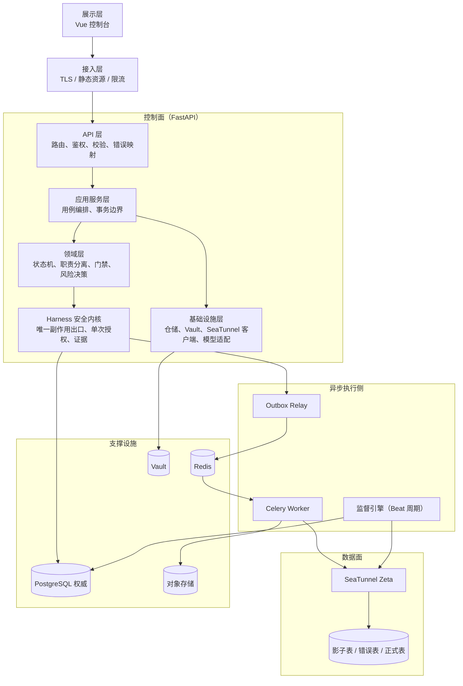
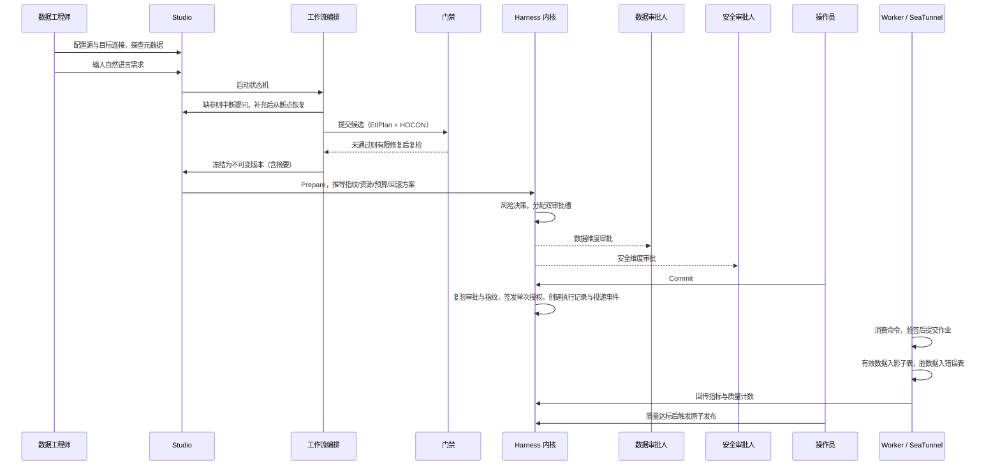

# 生产级 ETL-Agent 数据集成平台 概要设计

| 项目 | 内容 |
| --- | --- |
| 文档版本 | v1.1 |
| 文档状态 | 概要设计 |
| 编制日期 | 2026-11-23 |
| 文档定位 | 确定技术选型、系统架构、业务流程与数据结构方向，作为后续 Spec 文档的输入 |
| 依据文件 | 《生产级 ETL-Agent 数据集成平台-项目要求》（权威口径）、《ETL-Agent平台-PRD》、《ETL-Agent平台-数据实体设计》 |
| 权威顺序 | 项目要求 > PRD > 数据实体设计 > 本文 |
| 指导对象 | Spec-01 ~ Spec-10（见第 11 章） |

## 1. 概述

### 1.1 本文的定位与边界

概要设计解决"用哪些技术、系统怎么分层、业务怎么流转、数据怎么组织"，为后续逐模块的 Spec 文档确定方向。它刻意**不做**以下事情：不写字段级 DDL、不写接口请求响应全量 Schema、不写算法实现与事务内具体语句、不冻结未在原始文档中给出的数值指标。这些属于 Spec 与详细设计阶段。

判断标准很简单：本文的每条结论都应回答"后续 Spec 必须遵守什么"，而不是"后续 Spec 具体怎么写"。

### 1.2 系统定义

面向企业异构数据集成场景的**控制面平台**：数据工程师用自然语言描述需求，系统在受管元数据范围内生成 ETL 方案与 SeaTunnel 配置，经确定性门禁冻结为不可变版本，由数据与安全两名审批人独立审批后，签发单次授权令牌并异步驱动 SeaTunnel 执行；执行过程受预算监督，有效数据入影子表、脏数据入错误表，质量达标后原子发布为正式表，全链路关键事实写入防篡改证据账本。

### 1.3 设计原则

整份设计的取舍围绕五条原则：

1. **模型只出候选**。任何配置在成为可审批制品前必须经过不依赖模型的确定性门禁，模型不能自证正确。
2. **审批针对冻结事实**。审批对象是不可变制品 + 冻结快照，事实漂移即授权失效。
3. **执行需单次授权**。"已登录"不等于"可执行"，中间必须有一道与制品、工具、主体、环境绑定且只能用一次的凭证。
4. **执行可收敛**。任何运行都能被观测、被预算约束、被中断、被清理，失败不得污染正式表。
5. **证据可验证**。关键控制事实以哈希链 + 签名固化，可脱离数据库独立验证。

安全相关能力一律 fail-closed，展示与统计能力允许降级。

---

## 2. 技术选型

### 2.1 选型总表

| 层 | 技术 | 选型理由 |
| --- | --- | --- |
| 前端框架 | Vue 3 + TypeScript + Vite | 项目要求指定 Vue；组合式 API 便于抽离 Studio 复杂状态 |
| 前端组件 | Element Plus | 表单、表格、审批卡片、步骤条覆盖度高，减少自研 |
| 状态管理 | Pinia | 轻量、类型友好 |
| 拓扑与配置展示 | AntV X6（或 Vue Flow）+ Monaco Editor | DAG 交互渲染 + HOCON 语法高亮与只读 Diff |
| 图表 | ECharts | 吞吐曲线、错误码分布、评测大盘 |
| 控制面框架 | FastAPI（Python 3.11+） | 异步、Pydantic 契约驱动、OpenAPI 自动产出，便于前后端对齐 |
| 数据校验 | Pydantic v2 | 请求、响应、内部载荷使用同一套契约 |
| 持久化访问 | SQLAlchemy 2.0 async + Alembic | 显式事务控制、迁移可回滚 |
| 工作流引擎 | LangGraph | 原生支持中断与 Checkpoint，直接对应"可恢复状态机"要求 |
| 异步任务 | Celery + Redis | 项目要求指定；重试、路由、Beat 周期能力成熟 |
| 权威存储 | PostgreSQL 16 | 事务、唯一约束、行级安全、JSONB、advisory lock 齐全 |
| 缓存与队列 | Redis 7 | Broker、分布式锁、短时运行态；不承载任何权威事实 |
| 密钥管理 | Vault KV v2 | 项目要求指定；Secret 版本化与轮转 |
| 数据面 | Apache SeaTunnel Zeta 2.3.x | 项目要求指定；连接器覆盖目标源类型 |
| 签名算法 | Ed25519 | 项目要求指定；密钥短、验签快 |
| 可观测 | OpenTelemetry + 结构化日志 | 满足 trace 贯穿要求 |

### 2.2 关键选型的取舍说明

**为什么 LangGraph 而不是自研状态机或 Airflow。** 需求澄清需要"中断—等待人工—从断点恢复"，LangGraph 的 interrupt + Checkpointer 天然是这个模型；自研要重新实现状态序列化与恢复兼容性，Airflow 面向批调度、不适合按请求推进的交互式状态机。

**为什么控制面单库而不拆库。** 平台的核心价值是"审批事实、授权事实、执行事实三者强一致"，跨库无法用单事务保证 Commit 的原子性。代价是指标类高频写入会压在主库上，因此要求指标表分区并按保留期压缩，而不是靠拆库解决。

**为什么策略做成"数据"而不是代码常量。** P0–P3 规则矩阵原始文档未冻结，写死在代码里会导致每次调整都要发版；做成版本化规则表后，可以通过 Benchmark 回归后再上线。

**为什么所有副作用收敛到单一出口。** 授权校验、重放防护、审计与证据都需要一个绕不过去的拦截点。分散在各模块里调用外部系统，任何一处遗漏都等于授权旁路。

**为什么证据链异步补写而不阻塞主事务。** 链内写入需要串行化，放进主事务会造成锁竞争与长事务。代价是存在"主事实已提交、证据尚未落链"的窗口，因此要求链序号空洞可检测且有补偿任务。

### 2.3 技术风险

| 风险 | 说明 | 应对方向 |
| --- | --- | --- |
| LangGraph 版本演进快 | Checkpoint 格式与图语义可能变化 | 记录 `graph_version` 与格式版本，恢复时显式校验兼容性 |
| 单库承载指标写入 | 采样高峰影响主库 | 分区、批量写、必要时指标独立实例 |
| SeaTunnel 目标端能力差异 | 原子 Swap 依赖具体引擎能力 | 以适配器抽象，SQL 能力差异在适配器内消化 |
| 模型输出不稳定 | 结构化输出仍可能不合规 | 强制 Schema 约束 + 门禁兜底 + 有限修复轮次上限 |

---

## 3. 系统架构

### 3.1 架构风格

采用**控制面与数据面分离**，控制面内部为**分层单体 + 异步执行侧车**：单一 FastAPI 应用承载全部治理域，模块间以进程内边界保持可拆分性；执行与监督以独立进程运行，与 API 生命周期解耦。

不采用微服务的原因：当前规模下，模块边界用代码约束即可，拆分会把"审批—授权—执行"的强一致事务变成分布式事务，收益低于成本。

### 3.2 逻辑分层

| 层 | 职责 | 不承担 |
| --- | --- | --- |
| 展示层 | 交互、状态呈现、按能力清单渲染入口 | 任何授权裁决、持有 Secret |
| 接入层 | TLS、静态资源、请求体限制、基础限流 | 业务鉴权 |
| API 层 | 路由、鉴权依赖、请求校验、错误映射 | 业务编排 |
| 应用服务层 | 用例编排、事务边界、领域事件 | 搬运业务数据 |
| 领域层 | 状态机、职责分离、门禁、风险决策 | 外部 I/O |
| Harness 内核 | 风险决策、审批编排、单次授权、副作用出口、证据固化 | 业务语义判断 |
| 异步执行侧 | 命令消费、作业提交、指标回传、预算监督 | 修改审批事实 |
| 数据面 | 数据搬运、转换、分流写入 | 权限与授权判定 |

### 3.3 运行时拓扑

| 部署单元 | 说明 |
| --- | --- |
| `web` | SPA 静态资源 + 反向代理 |
| `api` | 无状态，可水平扩展；状态全部外置 |
| `worker` | Celery Worker，按 `exec` / `meta` / `bench` 分队列 |
| `beat` | 单活，负责调度触发与监督周期 |
| `relay` | 单活（或带租约），投递 Outbox 事件 |
| `postgres` / `redis` / `vault` / `minio` | 权威存储、队列缓存、密钥、制品与日志 |
| `seatunnel` | 数据面执行引擎，暴露提交与状态查询 |
| `demo-mysql` / `demo-doris` | 演示源与目标，支撑 L2 真实链路评测 |

关键约束：`beat` 与 `relay` 必须单活，否则重复触发与重复投递；`api` 与 `worker` 不共享内存状态，一切协作经数据库与队列。

### 3.4 架构约束

以下为强制约束，应作为代码评审与架构守护测试的检查项：

| 编号 | 约束 |
| --- | --- |
| C-01 | 除 Harness 内核外，任何模块不得直接发起外部副作用调用 |
| C-02 | 生成与门禁模块不得依赖数据面客户端 |
| C-03 | 执行与监督模块不得更新审批、准备单、Commit 事实 |
| C-04 | 审计与证据表只允许追加，禁止更新与删除 |
| C-05 | 前端不得持有或传递 Secret 值，只能提交引用 |
| C-06 | 门禁模块不得引入模型调用依赖 |
| C-07 | 执行对象必须以制品摘要标识，不能仅用可变 ID |
| C-08 | 演示或测试开关不得出现在执行协议链路 |

---

## 4. 模块划分

模块边界与数据实体设计的数据域前缀对齐，原则是"跨模块读允许、跨模块写禁止"，唯一例外是 Commit 事务内由 Harness 内核创建执行记录（以原子性为唯一理由，需在代码层显式标注）。

| 编号 | 模块 | 数据域 | 核心职责 |
| --- | --- | --- | --- |
| M01 | 身份与租户 | `iam_` | 认证、会话、项目、成员、角色，输出请求上下文 |
| M02 | 凭据与连接 | `asset_` | Secret 引用、连接登记、连通性测试、轮转 |
| M03 | 元数据探查 | `meta_` | 只读探查、Profile 版本化、统计、脱敏采样 |
| M04 | Studio 会话 | `studio_` | 会话与消息、澄清中断、动态表单 Schema |
| M05 | 工作流编排 | `flow_`、`ai_` | LangGraph 图、Checkpoint、模型适配、有限修复 |
| M06 | 候选与门禁 | `gen_`、`pipe_` | 候选生成、确定性门禁、版本冻结、版本 Diff |
| M07 | Harness 内核 | `harness_` | 风险决策、准备单、审批、Commit、单次授权、副作用出口、Outbox、证据 |
| M08 | 执行调度 | `exec_` | 受管命令消费、作业提交、尝试记录、指标回传 |
| M09 | 监督与诊断 | `exec_` | 预算比较、预警、硬中断、失败快照、根因诊断 |
| M10 | 质量与发布 | `exec_` | 质量报告、错误码统计、原子发布、受管回滚 |
| M11 | 审计与证据 | `audit_`、`harness_` | 审计事件、证据链追加与验证、签名密钥元数据 |
| M12 | 评测与策略 | `bench_`、`harness_` | Benchmark 套件与运行、指标大盘、策略版本 |

前端模块：F1 连接与 Profile 管理、F2 Studio 交互、F3 版本与 Diff、F4 审批与准备单、F5 运行监控、F6 治理与评测、F7 工程骨架（路由守卫、统一请求层、错误码映射、事件订阅）。前端按后端返回的能力清单渲染入口，但不作为授权依据。

依赖方向为单向：M01 → M02 → M03 → M05 → M06 → M07 → M08 → M09/M10 → M11，M12 横向依赖 M06、M07、M11 用于评测与策略。具体依赖细则在各模块 Spec 中定义。

---

## 5. 业务流程

### 5.1 主流程：需求生成与受管发布

主流程的关键节点：

1. **需求解析与澄清**：解析在脱敏上下文内进行；缺参触发中断，补充后从 Checkpoint 恢复，恢复前校验图版本与元数据 Profile 兼容性。
2. **生成与门禁**：模型产出结构化候选，门禁做语法与 Schema 对齐等确定性校验；未通过可进入有限修复，轮次有上限，超限转人工。
3. **版本冻结**：冻结时重新计算摘要，不信任候选记录中的旧值。冻结后组件不可改，仅状态可变。
4. **准备与审批**：Prepare 阶段推导输入指纹、资源范围、数据分级、执行预算与回滚方案，冻结为准备单并分配职责槽；准备阶段不产生任何外部副作用。
5. **Commit**：单事务内完成复验、签发授权、创建执行记录、写入投递事件，任一步失败整体回滚，不允许部分成功。
6. **执行与发布**：Worker 验签后物化短时凭据并提交作业；质量达标且预算未越界才允许原子发布；失败或超限走受管回滚，正式表始终不被污染。

### 5.2 三阶段协议的职责边界

| 阶段 | 做什么 | 不做什么 |
| --- | --- | --- |
| Prepare | 推导并冻结指纹、资源、分级、预算、回滚方案；分配职责槽 | 不调用外部系统、不产生执行记录、不签发授权 |
| Approve | 具名审批人基于冻结事实独立决策，强制申请人不自批、高风险双槽不同人 | 不修改准备单事实；审批后事实漂移即失效 |
| Commit | 复验审批与指纹、签发单次授权、创建执行记录与投递事件 | 不在事务内调用队列或外部 HTTP、不允许部分落库 |

### 5.3 执行、监督与发布

- **执行**：Worker 先验签与核对绑定项，再物化短时凭据；凭据不落盘、不进日志、不写入持久化配置副本，结束/失败/取消/退出四条路径都清理。
- **监督**：与 Worker 解耦的独立周期任务，比较实际指标与冻结预算，产出预警或硬中断。指标采集走双通道（采样表 + 引擎状态查询），判断时取更严格的一侧，避免 Worker 崩溃后指标断流导致漏判。
- **发布**：前置条件逐项由服务端校验（质量通过、拒绝率达标、无阻断事件、预算未越界、资源一致、具备发布授权），不接受前端传入的布尔值。发布后通过原子交换替换正式表。
- **回滚**：先取消残留作业，再清理未发布的影子与错误数据，若已发布则恢复到上一有效引用，最后写回证据。

### 5.4 需要提前对齐的三个设计约定

这三点在原始文档中没有完全展开，但会影响后续 Spec 的写法，建议在 Spec 阶段前先确认：

1. **"试运行"的边界**。Prepare 阶段不得有外部副作用，因此试运行在本文中限定为受限离线校验：本地配置解析、基于已冻结元数据的类型与映射推导、以及对源端的受管只读采样。不提交作业、不创建执行记录、不消费授权。若后续要引入真实小样本试跑，必须作为独立阶段并单独授权。
2. **调度触发的授权语义**。推荐方案为"审批窗口内每次执行仍签发新授权"：审批在准备单声明的窗口与预算内一次有效，每次调度触发都创建新的 Commit 与新的单次授权，预算按累计扣减。不采用"一次审批反复执行"（违反单次消费）与"调度跳过审批"（违反明确禁止）。
3. **硬中断的执行主体**。用户授权令牌有效期仅 5 分钟，不能作为中断能力的依赖，因此硬中断与取消以系统服务主体经受管出口发起，并单独留证；这样即使无人在线、Worker 已崩溃，仍能收敛运行。

---

## 6. 数据结构

### 6.1 存储分工

| 存储 | 承载内容 | 失效影响 |
| --- | --- | --- |
| PostgreSQL | 全部协议事实、制品摘要、审批、执行状态、质量、证据、评测 | 系统不可用（唯一权威） |
| Redis | 队列、锁、限流、短时快照、快速负缓存 | 队列临时中断；不丢失任何事实 |
| Vault | Secret 值（唯一来源） | 无法执行，须阻断而非降级为明文 |
| 对象存储 | 大制品、脱敏日志、失败快照 | 查看与诊断降级 |
| 数据面存储 | 业务数据、影子表、错误表、正式表 | 执行失败，正式表不受影响 |

### 6.2 数据域与不可变边界

| 对象 | 不可变内容 | 可变内容 |
| --- | --- | --- |
| 元数据 Profile | 对象、字段、统计、样本集合 | 无 |
| Pipeline 版本 | 全部组件与摘要、来源候选、Profile 引用 | 状态 |
| 准备单 | 快照、指纹、资源、预算、回滚方案、职责槽 | 状态 |
| 审批决定 | 全部字段 | 无（只追加） |
| 单次授权 | 唯一标识、绑定项、有效期、摘要、签名 | 消费状态 |
| 执行记录 | 关联 Commit、制品摘要、准备单 | 状态、指标、时间 |
| 质量报告 | 计数、比率、规则摘要 | 状态 |
| 证据记录 | 全部字段 | 无 |

### 6.3 摘要体系

所有不可变对象采用内容寻址：摘要只由业务内容决定，不得包含数据库自增 ID、创建时间、随机 UUID 等非业务字段；集合类型必须定义排序键，不能依赖数据库返回顺序。

这一条是后续 Spec 的硬约束：**系统必须提供"给定版本重算摘要"的能力**，摘要不可复算即视为设计缺陷。

规范化规则的具体细则（键序、数字表示、时间精度、空值语义）在 Spec 中定义，本文只固定原则。

### 6.4 三层状态隔离

| 状态层 | 载体 | 含义 | 禁止 |
| --- | --- | --- | --- |
| 对话状态 | 会话与消息 | 自然语言交互历史 | 存 Secret 明文、替代执行事实 |
| 工作流状态 | 工作流运行与 Checkpoint | 节点推进与中断恢复 | 表示数据面实际运行状态 |
| 执行状态 | 执行记录与尝试 | 实际运行、作业标识、指标 | 脱离制品摘要、被工作流状态覆盖 |

三层通过制品摘要与工作流运行标识显式关联，不共用同一状态载体。

---

## 7. 接口概要

### 7.1 通用约定

REST + JSON，路径前缀 `/api/v1`；长任务异步，返回对象标识与状态。所有写操作要求幂等键，相同键不同请求体返回冲突。请求入口生成或透传追踪标识，贯穿工作流、授权、执行与审计。响应统一脱敏，敏感字段不出现在任何响应中。分页采用游标方式，禁止无限量返回。

### 7.2 接口分组

| 分组 | 覆盖能力 |
| --- | --- |
| 认证与项目 | 登录登出、当前用户能力清单、项目与成员、角色分配 |
| 连接与元数据 | 连接增删改查、连通性测试、凭据轮转、探查发起、Profile 查询与结构对比 |
| Studio 与生成 | 会话与消息、工作流恢复、候选生成、门禁校验、版本冻结与 Diff |
| 治理协议 | 准备单创建与查询、槽位审批、Commit |
| 执行与运行 | 执行记录、事件流、指标、日志、暂停/取消/回滚 |
| 质量与发布 | 质量报告、原子发布 |
| 审计与证据 | 证据查询与验证 |
| 评测与策略 | 套件、评测触发与结果、策略版本发布 |
| 工作台 | 项目概览汇总 |

端点级契约（请求体、响应体、状态码、权限）在 Spec-05 与 Spec-09 中定义。

### 7.3 错误与事件

错误码按域分前缀（认证、连接、元数据、工作流、制品与门禁、协议与授权、执行、质量、评测、系统），响应体固定包含错误码、可读消息、追踪标识、对象类型与标识、是否可重试。协议类拒绝必须使用稳定错误码，覆盖自批、槽位人不符、双槽同人、未审批即提交、指纹不一致、准备单过期、授权过期、授权重放、授权范围不符、签名无效、预算越界、质量未通过即发布、门禁未通过即冻结。

运行状态通过事件推送（优先 SSE，轮询降级），事件类型覆盖工作流状态变化、准备单创建、审批决定、指标采样、监督触发、质量结果、发布与回滚完成、证据追加。

### 7.4 外部集成

对 SeaTunnel 只依赖三个能力（提交、查状态、取消），不深入引擎内部结构以降低版本耦合。对 Vault 只做短时凭据读取与版本引用。对模型 Provider 采用统一适配接口，强制结构化输出，每次调用记录模型版本与请求结果摘要，保证"这个方案是哪个模型版本生成的"可追溯。

---

## 8. 安全设计概要

### 8.1 控制要点

| 威胁 | 控制手段 |
| --- | --- |
| 伪造审批 | 槽位归属校验 + 审批决定绑定快照 + Commit 复验 |
| 越权执行 | 授权绑定制品与工具 + 单次消费 + 短有效期 |
| 重放 | 唯一约束保证一次性消费，缓存仅作加速不作依据 |
| 制品偷换 | 内容寻址摘要 + 执行前多方核对 |
| 凭据泄露 | 只存引用 + 日志过滤 + 模型上下文扫描 + 响应脱敏 |
| 数据污染 | 影子表强制隔离 + 发布前置逐项校验 |
| 证据篡改 | 追加写 + 哈希链 + 签名 + 序号空洞检测 |
| 内部人滥用 | 策略版本化 + 变更审计 + 门禁不受模型影响 |

### 8.2 职责分离的三层拦截

展示层按角色与槽位归属禁用入口（减少误操作）；应用服务层做最终裁决（自批、槽位归属、双槽不同人、角色有效期）；数据层以唯一约束与事务内二次校验防绕过。三层缺一即视为缺陷。

### 8.3 凭据与脱敏

凭据登记只提交引用，服务端写入密钥后端后仅回传引用；被活动连接或冻结版本引用时不允许删除。数据出口（前端、模型上下文、日志、异常信息、证据、对象存储）统一走脱敏管道；错误表中的原始值属受控数据，仅经授权诊断视图按最小必要访问并留痕。

---

## 9. 非功能与部署概要

### 9.1 可靠性要点

| 组件失效 | 处理方向 |
| --- | --- |
| API 实例崩溃 | 多副本 + 客户端重试（幂等键保护） |
| Worker 崩溃 | 监督进程独立判定，可取消或标记失败，按需回滚 |
| Beat / Relay 停止 | 单活重启；未投递事件仍在事件表，可从待投递状态续投 |
| Redis 清空 | 事实不丢，队列需重建；不得因此丢失任何协议事实 |
| Vault 不可用 | 阻断执行并告警，禁止降级为明文 |
| 签名服务不可用 | 阻断 Commit（fail-closed），不得签发未签名授权 |

重试原则：只读探查、门禁、指标回传、投递可重试；Commit 不重试但幂等返回既有结果；原子发布与回滚需先查状态再决定，状态不确定时要求人工确认。

### 9.2 可观测要点

统一追踪标识贯穿请求入口 → 工作流节点 → 模型调用 → 门禁 → 准备 → 审批 → Commit → 事件投递 → 授权消费 → Worker → 作业 → 质量 → 发布/回滚 → 证据。核心指标分域采集：应用（延迟、错误率、连接数）、工作流（节点耗时、中断与恢复次数、修复轮次、门禁失败率）、授权（签发/消费/拒绝、重放次数、审批时长）、投递（积压量、最老事件年龄、死信数）、执行（成功率、时长、读取量、写入量、拒绝率）、质量（报告通过率、错误码分布、发布与回滚次数）、证据（追加量、验证失败、空洞检测）。

### 9.3 部署与配置

依赖启动顺序为数据库 → 缓存 → 密钥 → 迁移 → API → 投递 → Worker → Beat → 数据面 → 演示数据源。每个服务提供存活与就绪两类探针，就绪探针需校验数据库可连与迁移版本匹配。

配置分组为应用、数据库、缓存、密钥、签名、数据面、模型、协议参数、演示环境。敏感项一律由环境注入或密钥后端提供，配置文件只出现占位符。

安全相关能力 fail-closed，展示与统计允许降级（指标走缓存并标注数据时间）。外部依赖设熔断，熔断期间返回明确错误而非长时间挂起。

---

## 10. 待确认事项

以下事项原始文档未冻结，需在对应 Spec 编写前确认，否则会阻塞实现：

| 编号 | 事项 | 阻塞阶段 |
| --- | --- | --- |
| TBD-01 | P0–P3 完整风险策略矩阵；低风险是否免双审 | Harness 协议 Spec |
| TBD-02 | 多模型 Provider 清单、优先级与版本治理 | 工作流 Spec |
| TBD-03 | 认证方式与企业 SSO 接入；项目管理员权限边界 | 身份与租户 Spec |
| TBD-04 | 各源端连接器认证方式、网络出站策略、最小权限模板 | 连接与元数据 Spec |
| TBD-05 | 文件接入的暂存区布局、生命周期与清理 | 连接与元数据 Spec |
| TBD-06 | 原子发布在非 Doris 目标端的支持范围 | 质量与发布 Spec |
| TBD-07 | 调度触发的授权语义（5.4 推荐方案是否采纳） | Harness 协议 Spec |
| TBD-08 | 监督采样周期、预警与硬中断阈值默认值 | 执行与监督 Spec |
| TBD-09 | 准备单默认有效期与审批超时策略 | Harness 协议 Spec |
| TBD-10 | 错误表原始值加密方式、可访问角色与保留周期 | 质量与发布 Spec |
| TBD-11 | SLA、并发、容量、日志与证据保留、灾备指标 | 上线评审 |
| TBD-12 | Benchmark 数据集来源、标注负责人与发布节奏 | 评测 Spec |

---

## 11. 后续 Spec 文档方向

本文为下列 Spec 提供方向与约束，每个 Spec 应在开头声明"遵守概要设计第几章"：

| 编号 | Spec 文档 | 覆盖范围 | 主要输入 |
| --- | --- | --- | --- |
| Spec-01 | 身份与租户 | 认证方式、会话模型、项目与成员、角色定义、租户上下文与行级隔离 | 第 3.4、4、8.2 节 |
| Spec-02 | 连接与元数据探查 | 连接类型与表单模型、凭据引用与轮转、探查范围与限流、脱敏规则、Profile 版本化 | 第 4、6.2、8.3 节 |
| Spec-03 | Studio 与工作流编排 | 会话模型、澄清中断与动态表单、图节点定义与 Checkpoint 契约、恢复兼容规则、有限修复策略 | 第 5.1、5.4、6.4 节 |
| Spec-04 | 候选生成与门禁 | 候选结构、门禁规则集与版本、finding 结构、冻结与摘要计算、版本 Diff | 第 5.1、6.3 节 |
| Spec-05 | Harness 治理协议 | 风险决策规则、准备单字段、职责槽与审批、Commit 事务边界、单次授权结构与校验、副作用出口工具注册、事件投递、证据链 | 第 5.2、5.4、6.2、6.3、8 节 |
| Spec-06 | 执行与监督 | 命令消费与验签、凭据物化与清理、作业提交与状态映射、指标采集双通道、预算比较与中断判定、诊断输出 | 第 5.3、9.1 节 |
| Spec-07 | 质量与发布 | 质量规则与契约、错误码体系、分流统计口径、报告结构、发布前置校验、发布适配器、回滚序列 | 第 5.3、6.2 节 |
| Spec-08 | 评测与策略 | 套件与用例版本、分层评测方式、指标定义与计算、策略版本发布流程 | 第 4、10 节 |
| Spec-09 | 前端交互 | 页面信息架构、路由与权限守卫、统一请求层与错误处理、事件订阅、关键交互流程 | 第 4、7 节 |
| Spec-10 | 数据模型与迁移 | 表结构与约束、索引与分区、迁移策略、初始化数据 | 第 6 章 + 数据实体设计 |

建议的推进顺序为 Spec-01 → Spec-02 → Spec-05 → Spec-03/04 → Spec-06/07 → Spec-09 → Spec-08 → Spec-10。先做 01/02 是为了让后续 Spec 有真实的上下文对象与元数据可用；提前做 05 是因为它是全部安全约束的落点，越晚做返工面越大。
